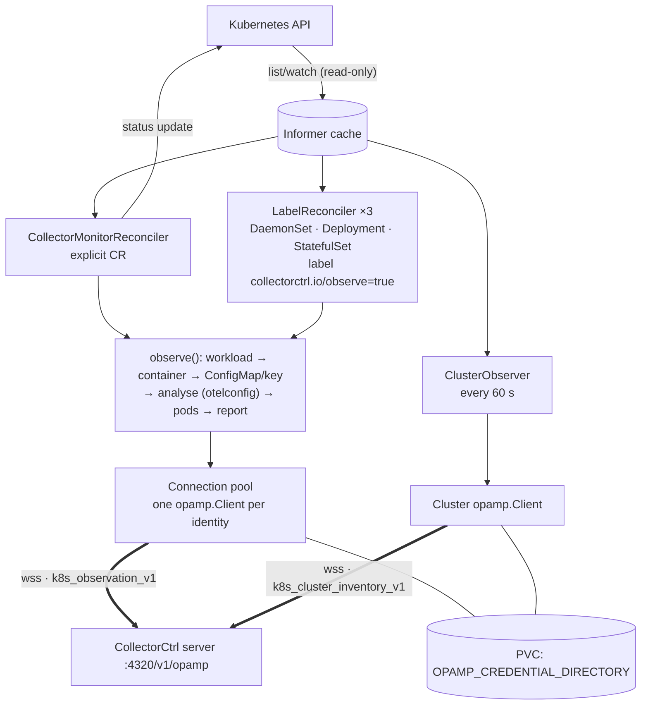

# CONTEXT: CollectorCtrl Kubernetes Operator

Working context for teammates and AI assistants. Every statement here comes from the code, config and docs in this
repository as of operator **0.7.0** / Helm chart **0.3.0** (main, October 2026). Anything not confirmed by the repo is
under [Open questions](#10-open-questions).

> Despite the name, this is an **observer**, not a controller: it never writes to collector workloads, ConfigMaps or
> application pods. The only object it writes is the `status` of its own `CollectorMonitor` resources.

---

## 1. Purpose

Reports OpenTelemetry Collector workloads (Deployment, DaemonSet, StatefulSet) running in a Kubernetes cluster to the
CollectorCtrl server over OpAMP, so they appear next to host collectors in the CollectorCtrl UI. Deployment stays
with the customer's Helm charts, vendor operators and CI/CD.

How it fits with the other CollectorCtrl repos:

| Repo | Role | Relationship to this repo |
| --- | --- | --- |
| **CollectorCtrl-K8s-Operator** (this) | Kubernetes observer, Apache-2.0, public | Sends `k8s_observation_v1` / `k8s_cluster_inventory_v1` to the server |
| CollectorCtrl (public) | Releases, docs, OpenAPI spec, issue tracker for the control plane | Its docs call this component the "Kubernetes observer (pilot)" and document `opamp.enrollmentSecret`, single replica, credential PVC |
| Control-plane source (private) | Server, Supervisor, UI, Copilot, MCP | Consumes the wire contracts here; `docs/development.md` says the server repo holds `scripts/test-k8s-integration.ps1` (end-to-end with kind) |
| Website (collectorctrl.com) | Marketing and docs site | Not covered here |

## 2. Tech stack

| Area | Choice | Version (source) |
| --- | --- | --- |
| Language | Go | `go 1.24.0` (`go.mod`); builder image `golang:1.24-alpine` |
| Controller framework | controller-runtime | `v0.17.0` |
| Kubernetes client | `k8s.io/api`, `apimachinery`, `client-go` | `v0.29.0` |
| OpAMP | `github.com/open-telemetry/opamp-go` (WebSocket client) | `v0.23.0` |
| YAML | `gopkg.in/yaml.v3` | `v3.0.1` |
| IDs | `github.com/google/uuid` | `v1.6.0` |
| Logging | controller-runtime zap (`Development: true`) | via controller-runtime |
| Runtime image | `gcr.io/distroless/static:nonroot`, UID 65532 | `Dockerfile.operator` |
| Packaging | Helm 3 chart `collectorctrl-operator` | chart `0.3.0`, appVersion `0.7.0` |
| CI | GitHub Actions `build-operator.yml` | multi-arch linux/amd64, linux/arm64 |
| Target clusters | Kubernetes 1.25+ (README badge); EKS/AKS/GKE/OpenShift are "validation targets, not certified" | README |

Go module path is `github.com/collectorctrl/collectorctrl` (not the repo name). See [Gotchas](#9-gotchas).

## 3. Architecture

One process (controller-runtime manager), **one replica**. Three kinds of runnables share one informer cache and one
connection pool.

### Components

| Component | File | Trigger | Writes |
| --- | --- | --- | --- |
| Entry point | `cmd/operator/main.go` | process start | — |
| `CollectorMonitorReconciler` | `operator/controllers/collectormonitor_controller.go` | CR generation change; any ConfigMap/Pod/Deployment/DaemonSet/StatefulSet/ReplicaSet change in the CR's namespace; `RequeueAfter` = report interval | CR `status` |
| `LabelReconciler` (one per kind) | `operator/controllers/label_controller.go` | labelled workload create/update/delete (incl. label removal); ConfigMap/Pod/CollectorMonitor change in namespace; report interval | nothing (errors → log) |
| Analysis | `operator/controllers/insight.go`, `internal/otelconfig/` | every observation | nothing |
| `ClusterObserver` | `operator/controllers/cluster_observer.go` | 60 s ticker (`NeedLeaderElection() = true`) | nothing |
| OpAMP client + credentials | `pkg/opamp/client.go`, `pkg/opamp/credentials.go` | reconcilers | credential files on the PVC |
| `connectionLifetime` | `collectormonitor_controller.go` | manager shutdown | stops every client |

### Reconcile flow (`observe()`)

1. **Workload**: list DS/Deploy/STS in the CR namespace by `matchLabels` (+ optional `kind`, `name`). Must be exactly one, else error.
2. **Container**: single-container pod → that one; otherwise `collectorContainer` / `collectorctrl.io/container` is required.
3. **ConfigMap**: only ConfigMaps mounted into that container (incl. projected volumes); must be exactly one after `configMapSelector` filtering.
4. **Key**: explicit key, else the only `*.yaml|*.yml` key, else the only key mounted via `items` to a `*.yaml` path, else the only key in a single-key ConfigMap, else error. The key must actually be mounted (`items`, `subPath`; `subPathExpr` is never guessed).
5. **Analyse**: parse YAML pipelines, infer role, stack, export topology (`insight.go`).
6. **Connect**: `ensureConnection()` gets or replaces the client for the identity (fingerprint of spec, identity, cluster name, ConfigMap name, Secret resourceVersion, endpoint, auth mode, token, discovery/stack/role).
7. **Pods**: owned by controller UID (Deployment → ReplicaSet → Pod), sorted by name.
8. **Report**: `SetHealth` (readiness only) and, if connected, custom message `collectorctrl/k8s_observation_v1`. Snapshots are dropped while disconnected.

### Identities

| Connection | `service.instance.id` | Instance UID |
| --- | --- | --- |
| Observed collector | `k8s://<cluster-id>/<workload-uid>/<container>` | `md5(agentID)` as UUID |
| Cluster observer | `k8s://<cluster-id>/cluster-observer` | same scheme |

`service.name` is `kubernetes` (`api.AgentTypeKubernetes`). Cluster ID = `CLUSTER_ID` or the `kube-system` namespace UID.

### External dependencies

| Dependency | How |
| --- | --- |
| CollectorCtrl server | OpAMP over `wss://` only; endpoint pinned to `OPAMP_SERVER`; TLS ≥1.2, system roots + optional `OPAMP_CA_FILE`; no skip-verify option exists |
| Server auth | `Authorization: Enroll cce_…` → server returns `cca_…` credential (custom message `credentials/agent_credential`) → persisted, then acked → later `Authorization: Agent cca_…`. Legacy: `Secret-Key …` |
| Kubernetes API | read-only RBAC (see §7); `get` on `namespaces/kube-system` for cluster ID |
| Persistent volume | RWO PVC, `helm.sh/resource-policy: keep` |
| Prometheus (optional) | `:8080/metrics`, ServiceMonitor when `serviceMonitor.enabled` |

No database, LLM provider, OIDC or cloud SDK is used in this repo.

## 4. Repo map

| Path | What it is |
| --- | --- |
| `cmd/operator/main.go` | Flags, env vars, manager, cluster-ID discovery, registers reconcilers and cluster observer |
| `operator/api/v1alpha1/collectormonitor_types.go` | `CollectorMonitor` CRD types; hand-written DeepCopy and scheme registration (no controller-gen) |
| `operator/controllers/collectormonitor_controller.go` | CR reconciler, `observe()`, discovery, connection pool, status conditions |
| `operator/controllers/label_controller.go` | Label opt-in reconcilers; builds an in-memory ("synthetic") monitor from annotations |
| `operator/controllers/insight.go` | Label/annotation constants, role override, stack and export topology resolution |
| `operator/controllers/cluster_observer.go` | Cluster connection; candidate inventory by image-name hints (max 2,000) |
| `operator/controllers/*_test.go` | Fake-client tests; `vendorcharts_test.go` golden tests |
| `operator/controllers/testdata/vendorcharts/` | Rendered upstream, Splunk, Coralogix, ADOT chart manifests (fixtures) |
| `operator/config/crd/collectormonitor-sample.yaml` | Sample CR |
| `internal/otelconfig/` | `analysis.go` (pipeline-aware parse), `role.go` (role inference), `exports.go` (exporter endpoints) |
| `internal/integrationclient/main.go` | Build tag `k8s_integration`; process used by the server repo's end-to-end test; credentials via stdin |
| `pkg/opamp/` | OpAMP client, wire-contract structs, endpoint pinning, credential storage |
| `pkg/api/types.go` | Types "shared with the server"; only `AgentType` is used here (see §8) |
| `helm-charts/collectorctrl-operator/` | Chart; `crds/crd.yaml`, `templates/`, `values.yaml`, `values-openshift.yaml` |
| `deploy/` | Raw manifests mirroring the chart, `deploy.sh` (kubectl install), example CRs |
| `hack/render-vendor-charts.sh` | Regenerates vendor-chart fixtures (pinned chart versions) |
| `docs/` | architecture, installation, configuration, troubleshooting, development |
| `Dockerfile.operator`, `Makefile`, `.github/workflows/build-operator.yml` | Build, image, CI |

## 5. Build, run and test

Requirements: Go (from `go.mod`), Helm 3, Docker with Buildx for images; optional kind/any cluster.

| Task | Command |
| --- | --- |
| List targets | `make help` |
| Everything CI checks | `make verify` (= `fmt-check vet test helm-lint`) |
| Format / check | `make fmt` / `make fmt-check` (dirs: `cmd internal operator pkg`) |
| Vet | `make vet` |
| Unit tests (race + coverage → `cover.out`) | `make test` |
| Helm lint + render variants | `make helm-lint` (default, namespace-scoped, OpenShift, ServiceMonitor) |
| Binary → `bin/manager` | `make build` (`VERSION` from `git describe`) |
| Run against current kubeconfig | `make run` (needs env vars below) |
| Image | `make docker-build IMG=…` / `make docker-buildx` (multi-arch, pushes) |
| Chart render / package | `make helm-template` / `make helm-package` (→ `dist/`) |
| Refresh vendor fixtures | `make vendor-fixtures` (needs network + Helm; review expectation diffs by hand) |
| Integration client build | `go build -tags k8s_integration ./internal/integrationclient` |
| Clean | `make clean` |

CI (`build-operator.yml`): on PR/push to `main` and `v*` tags → checks `go mod tidy` is clean, runs `make verify`,
then builds the multi-arch image; pushes to GHCR except on PRs. Tags: `:main`, `:latest` (main), `:X.Y.Z` and `:X.Y`
(semver tags).

Release (from `docs/development.md`): move CHANGELOG *Unreleased* → version; bump `Chart.yaml` `appVersion`,
`version` and `artifacthub.io/changes`; bump image tag in `deploy/deployment.yaml`; merge; `git tag -a vX.Y.Z`;
push tag; create GitHub release.

### Environment variables (names only)

| Variable | Used for |
| --- | --- |
| `OPAMP_SERVER` | Required `wss://` endpoint; every connection is pinned to it |
| `OPAMP_AUTH_MODE` | `enroll` (default) or `legacy` |
| `OPAMP_ENROLL_TOKEN` | Enrollment token (`enroll` mode) |
| `OPAMP_SECRET_KEY` | Shared key (`legacy` mode only) |
| `OPAMP_CREDENTIAL_DIRECTORY` | Required, persistent, writable |
| `OPAMP_CA_FILE` | Optional extra PEM roots |
| `CLUSTER_ID` | Cluster identity; empty → `kube-system` UID |
| `CLUSTER_NAME` | Display name (defaults to cluster ID) |
| `CLUSTER_OBSERVER` | `false` disables the cluster connection |
| `WATCH_NAMESPACE` | Restrict cache to one namespace |
| `POD_NAMESPACE` | Logged only |

Flags: `--metrics-bind-address` (`:8080`), `--health-probe-bind-address` (`:8081`, `/healthz` `/readyz`), `--leader-elect`, plus zap flags.

## 6. Domain concepts

| Term | Meaning here |
| --- | --- |
| Observed collector | A collector workload that opted in; one OpAMP identity per workload UID + container |
| Opt-in label | `collectorctrl.io/observe: "true"` on the **workload** (not the pod template) |
| Annotations | `collectorctrl.io/container`, `config-map`, `config-key`, `stack`, `role`, `report-config`, `report-interval` (5 s–1 h, default 30 s) |
| `CollectorMonitor` (`cmo`) | Namespaced CR, `collectorctrl.io/v1alpha1`, for workloads whose labels can't be changed. Takes precedence over the label for the same workload |
| Synthetic monitor | In-memory `CollectorMonitor` built from a labelled workload's annotations; never written to the API (name prefix `@label/`) |
| Candidate | Workload whose container image repository matches a collector hint; listed in the cluster inventory without reading its config |
| Role | `agent`, `gateway`, `cluster-receiver`, `all-in-one`, `unknown`, always with `role_reasons` and `role_source` |
| Stack | Group of workloads deployed together: annotation → `OpenTelemetryCollector` owner → `app.kubernetes.io/instance` → `argocd.argoproj.io/instance` → own name |
| Export edge | Exporter endpoint classified as `workload`, `service`, `external`, `local`, `unresolved` |
| Observation vs verification | Mounted ConfigMap ≠ loaded config; ready pod ≠ delivered telemetry. `runtime_verified` is always `false` |
| Wire contracts | `k8s_observation_v1`, `k8s_cluster_inventory_v1` (OpAMP custom messages, capability `collectorctrl`) |
| Enrollment token / credential | `cce_…` (one use per new identity) → per-identity `cca_…` |

Terminology: in user-facing text say **collectors**. Internal identifiers still say "agent" (OpAMP terms,
`api.Agent*`, CRD status `agentCount`/`healthyAgents`, print column "Agents"); renaming those is an API change.

### CRD fields (`CollectorMonitor.spec`)

| Field | Status in 0.7 |
| --- | --- |
| `workloadSelector.matchLabels` (required in schema), `.kind` (enum), `.name` | Used |
| `collectorContainer` | Used |
| `configMapSelector.name`, `.matchLabels`, `.key` | Used |
| `opampServer` (required, pattern `^wss://`) | Must equal `OPAMP_SERVER` exactly |
| `auth.secretRef.name`, `.namespace` (must equal CR namespace), `.key` | Used; needs the Secret in `rbac.authSecretNames` |
| `reportConfig` | Used (uploads YAML) |
| `healthCheck.interval` | Used as report interval |
| `healthCheck.enabled`, `.metricsPort`, `driftDetection.*`, `enrichWithNodeMetadata` | Reserved, not read |
| `emergencyMode.enabled` | Deprecated; if true, sets condition `ControlEnabled=False` |

Status: `phase` (`Pending|Active|Error|Disconnected`), `agentCount`, `healthyAgents`, `configMapRef`,
`lastHeartbeat`, `conditions` (`Discovered`, `ConfigMapResolved`, `RuntimeConfigVerified`,
`TelemetryDeliveryVerified`, `OpAMPConnected`, `HealthReported`, `Active`, optional `ControlEnabled`).

## 7. Conventions and deliberate design decisions

**Ground rules (CONTRIBUTING.md, PR template)**

- Observe, never control. Writing to workloads, ConfigMaps or app pods needs a design issue first.
- Infer from evidence, never from names. Names/kinds only break ties (`InferRole` uses kind only when no role evidence).
- Say what is not verified (conditions use `Unknown` with explicit reasons).
- Wire contracts are additive: new optional fields only, matched by a server change; breaking → `_v2` message type.
- Config content leaves the cluster only with `report-config` / `reportConfig`.

**Code style**

- `gofmt` enforced (`make fmt-check`); `go vet`; race tests; `go mod tidy` must be clean in CI.
- Fail closed on ambiguity: return an error with the fix in the message (e.g. "specify configMapSelector.name to resolve ambiguity"). Never guess.
- Errors: `fmt.Errorf` with `%w` for wrapping I/O errors; reconcilers requeue after 30 s on failure.
- CR path writes errors to status conditions; label path logs (`logf.FromContext`) because there is no object to write.
- Comments explain *why* (e.g. why `groupbytrace` isn't gateway evidence).
- Tests use the controller-runtime fake client; golden tests against real vendor charts. Inference changes must update `vendorcharts_test.go` expectations by hand.

**Security decisions**

- No TLS skip-verify anywhere; `wss://` only; URL with credentials/query/fragment rejected (`ApprovedEndpoint`).
- Server-offered connection settings and all OpAMP commands are refused; `emergency` custom messages get `emergency_ack:false`.
- Credential written (temp file, fsync, rename) **before** ack; a revoked identity never falls back to the enrollment token. Storage is write-probed before a token is spent.
- Secret access only by name via `rbac.authSecretNames`; Secrets read with the uncached API reader.
- Hardened pod: non-root 65532, read-only root FS, all caps dropped, RuntimeDefault seccomp.

**Config patterns**: Helm values → env vars (chart is the only supported install; `deploy/` mirrors it). The chart
`fail`s on `replicaCount != 1`, bad `authMode`, missing enrollment Secret (unless `existingClaim`), and
namespace-scoped without `clusterID`.

**Branching / PRs**: feature branches `feat/…`, `fix/…`, `docs/…` merged to `main` via PR. Commit style is
Conventional Commits (`feat(operator): …`, `test(operator): …`, `style: …`). Update `CHANGELOG.md` under
*Unreleased* and docs for anything user-visible. One change per PR, with tests. Dependabot runs weekly for gomod
(Kubernetes grouped), Actions and Docker.

## 8. Current state

| Area | State |
| --- | --- |
| Label opt-in, CR monitors, ConfigMap/key discovery, pod readiness | Done (0.7.0) |
| Role / stack / topology inference | Done; golden-tested on 4 vendor charts |
| Cluster candidate inventory | Done; image-name hints only |
| Enrollment + persisted credentials | Done |
| Namespace-scoped install, OpenShift overlay | Present; OpenShift "still requires live restricted-v2 SCC validation" (`values-openshift.yaml`) |
| Managed-platform validation (EKS/AKS/GKE) | "Validation targets, not certified" |
| Runtime config verification, drift detection | Not implemented (`driftDetection` reserved; always `Unknown`) |
| Control of workloads, emergency mode | Deliberately not supported |
| mTLS / OIDC to server | `TODO` in `OpAMPAuth` |
| Instrumentation readiness, `JAVA_TOOL_OPTIONS` inspection | **Roadmap 0.8**, no code |
| Own `Instrumentation` CRD + webhook (Java), central profile, canary/revert | **Roadmap 0.9**, no code |
| Node.js / Python / .NET instrumentation, PRs to migrate vendor annotations | **Roadmap 1.0** |
| GitOps config storage | Not in this repo. `pkg/git` prototype was **removed** in 0.7.0 |
| Not supported (docs) | Secret-backed configs, `${env:…}` expansion, `--config` merges, remote providers, injected sidecars without a ConfigMap mount, OpenTelemetryCollector CRs (observed only after the upstream operator creates workloads), Alloy config (role `unknown`) |

**TODO/FIXME hotspots**: only one explicit `TODO` (`collectormonitor_types.go`: mTLS/OIDC auth). Other markers are
"Deprecated"/"reserved" fields in the CRD.

**Dormant code**: `pkg/api/types.go` defines `Agent`, `K8sContext` (with `GitCommit`/`GitRepo`), `FleetPolicy`,
`RolloutStrategy`, `ConfigChangeRequest` (`IsEmergency`) and `ConfigChangeResult`; none are referenced in this repo.
They describe an earlier control/GitOps design.

**Recent direction (git log, Oct 2026)**: v0.7 label discovery and inference (PR #2), vendor-chart golden tests
(#3, #5), cluster observer (#4), production README and release tooling (#6). Unmerged branches include
`docs/architecture-hld-lld` and several Dependabot bumps (opamp-go 0.25.0, Kubernetes group, Go 1.25 builder, Actions).

**Verified while writing this**: `make fmt-check`, `make vet`, `make test` (all pass; coverage otelconfig 95.6%,
controllers 66.9%, opamp 59.0%) and `make build` succeed on Go 1.24.7. `helm-lint` was not run (no Helm available).

## 9. Gotchas

- **Module path ≠ repo name.** Imports are `github.com/collectorctrl/collectorctrl/...`; don't "fix" it without a plan, it touches every import.
- **No git tags exist** on this repo yet, while the chart and `deploy/deployment.yaml` default to image tag `0.7.0`. CI publishes `:0.7.0` only from a `v0.7.0` tag, so a default install may hit `ImagePullBackOff` (troubleshooting doc mentions this).
- **Single replica is a hard requirement.** Credential storage has one writer; chart fails on `replicaCount != 1`; strategy `Recreate`. Leader election is off by default and only adds a Lease.
- **Losing the PVC orphans identities.** Credentials can't be recreated; each identity must be reset in CollectorCtrl and re-enrolled (one token use each). PVC has `resource-policy: keep`.
- **Token uses**: one for the cluster observer + one per opted-in workload. A recreated workload has a new UID → new identity, new enrollment, old entry stays offline.
- **Credential file name** = `sha256(endpoint + "\0" + instanceUID)`. Changing `OPAMP_SERVER` (even the path) means re-enrollment for every identity.
- **Changing `clusterID`** changes every identity. Never change it after install.
- **`opampServer` in a CR must match `OPAMP_SERVER` exactly** (normalised: lowercase host). Different endpoint = error.
- **Fan-out on watches**: any ConfigMap or Pod change enqueues every monitor / labelled workload of that kind in the namespace (`mapNamespace`). Busy namespaces cause many reconciles.
- **CR precedence**: label reconciler checks each CR in the namespace by re-running `discoverWorkload`; a CR displaces a label connection, never the reverse. Two CRs for one workload → error.
- **Label path has no status**: failures show only in operator logs.
- **`status.phase` `Pending`** is in the enum but never set by the code (only `Active`, `Error`, `Disconnected`).
- **Namespace-scoped mode** (`rbac.clusterScoped=false`): sets `WATCH_NAMESPACE` to the release namespace, so collectors must be in the **operator's own namespace**; the candidate list is limited to it too; `clusterID` is mandatory (no `kube-system` read).
- **`kube-system` lookup** at startup has a 15 s timeout and exits the process if it fails without `CLUSTER_ID`.
- **Default `opamp.server`** in `values.yaml` and docs is a placeholder internal-style hostname; always override.
- **Snapshots are dropped while disconnected** (not queued); `HealthReported` stays `Unknown` because server receipt isn't acknowledged.
- **Status conflicts**: `Reconcile` does `Status().Update` on a freshly read object; conflicts surface as reconcile errors and retry.
- **Two CRD copies**: `deploy/crd.yaml` and `helm-charts/.../crds/crd.yaml` are identical today and must stay so. Helm doesn't upgrade CRDs; apply them manually.
- **CRD is hand-maintained**: kubebuilder markers exist, but there is no controller-gen target; DeepCopy is hand-written. A new spec field needs the CRD YAML **and** DeepCopy updated by hand.
- **`.gitattributes`** normalises line endings (`text=auto`); shell scripts must keep LF.
- **Platform**: Linux containers only (amd64/arm64). No Windows node support is mentioned.

## 10. Open questions

1. Is a `v0.7.0` tag (and GHCR image `:0.7.0`) meant to exist? The repo has none, but CHANGELOG, chart and manifests reference 0.7.0.
2. The request mentions a **central Instrumentation CR, cross-namespace annotations, Java `JAVA_TOOL_OPTIONS` append behaviour and GitOps config storage**. None exist in this repo; the README lists instrumentation as 0.8/0.9 roadmap and `pkg/git` was removed. Are they in another branch or repo?
3. Should `pkg/api/types.go` (unused control/GitOps types) be removed or kept in sync with the server?
4. Versioning: operator 0.7.0 vs server 0.6.3-beta vs chart 0.3.0. Is there a compatibility matrix (minimum server for `k8s_cluster_inventory_v1`, label/role fields)?
5. Is a published Helm repository planned? Install currently requires cloning the repo.
6. Server-side contract: `docs/development.md` says new fields must be added to `pkg/api` and server validation together, but the wire structs live in `pkg/opamp`. Which is canonical?
7. Should the CRD's `Agents` print column / `agentCount` be renamed to collector terminology in a future `v1alpha2`?
8. What does `docs/architecture-hld-lld` (unmerged branch) contain, and is it meant to land?
9. Is GA (Jan–Feb 2027) for this component still "pilot" for read-only observation, per the main repo's maturity table?
