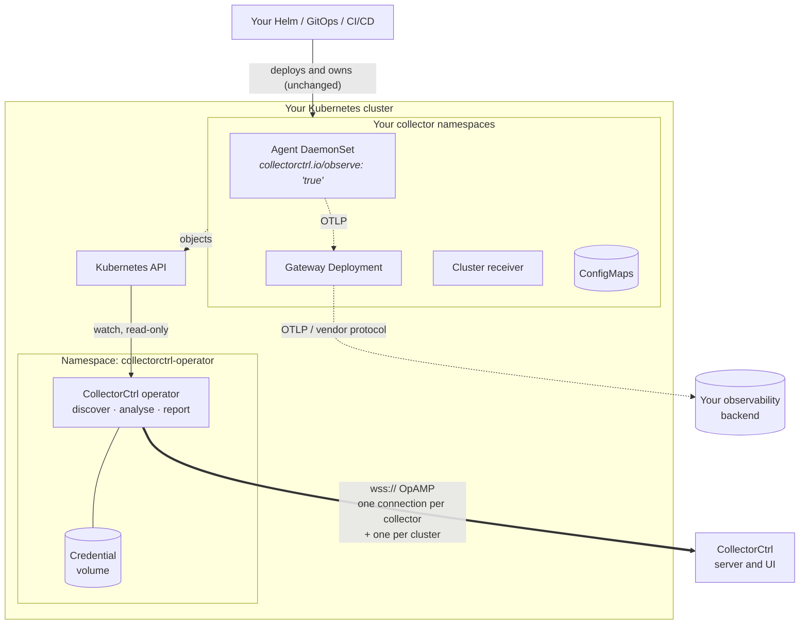
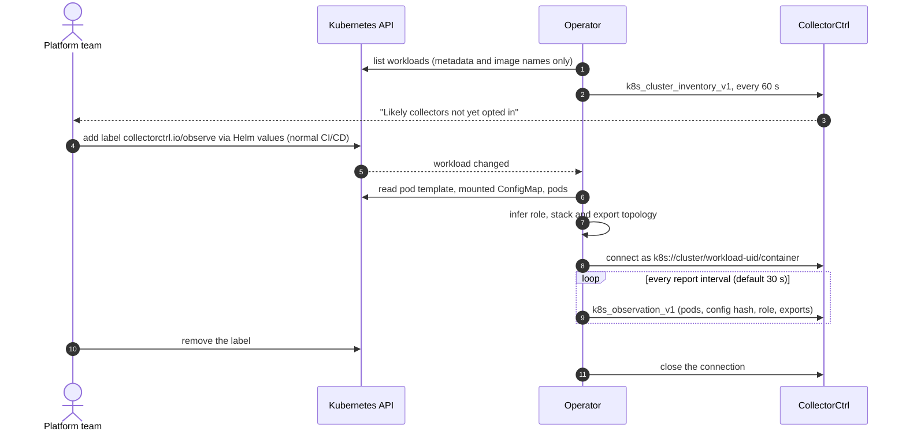
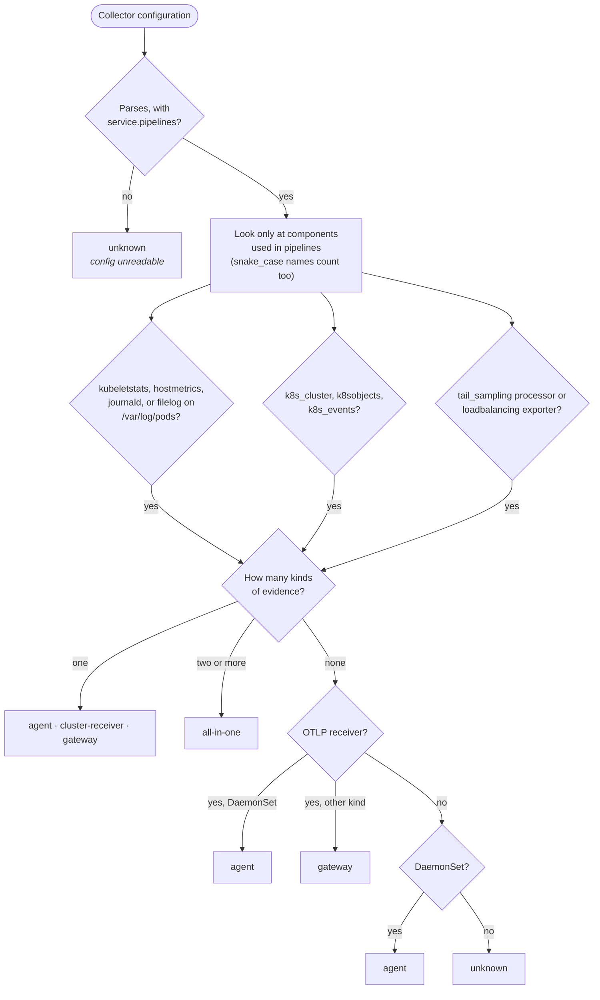
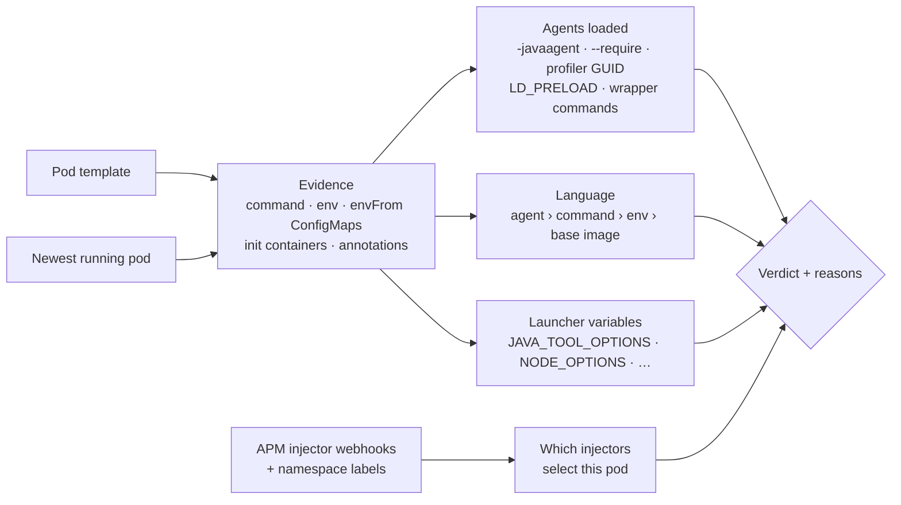

# CollectorCtrl Kubernetes Operator

[](https://github.com/CollectorCtrl/CollectorCtrl-K8s-Operator/actions/workflows/build-operator.yml)
[](LICENSE)


**See every OpenTelemetry Collector in your clusters, whatever vendor chart deployed it, without handing over control.**

The operator runs in your cluster, observes the collector workloads you opt in, and reports them to
[CollectorCtrl](https://collectorctrl.com) over [OpAMP](https://opentelemetry.io/docs/specs/opamp/): health per pod,
the configuration they run, the **role** each collector plays, how collectors are grouped into **stacks**, and
**where each one sends data**. For your applications it reports **instrumentation readiness**: which APM agents
(any vendor) already run where, which injectors would act on each pod, and which workloads could take an
OpenTelemetry agent. Your Helm charts, vendor operators and CI/CD keep deploying and owning those workloads. The
operator never changes them.

> **Status: 0.8, observation only.** The operator reads; it never writes to collector workloads, ConfigMaps or
> application pods. See the [roadmap](#roadmap) for what comes next.

---

## Contents

- [Why](#why)
- [How it works](#how-it-works)
- [The opt-in journey](#the-opt-in-journey)
- [What you see in CollectorCtrl](#what-you-see-in-collectorctrl)
- [Instrumentation readiness](#instrumentation-readiness)
- [Quick start](#quick-start)
- [Opt in a collector](#opt-in-a-collector)
- [Tested collector charts](#tested-collector-charts)
- [Security](#security)
- [Configuration](#configuration)
- [Compatibility and limits](#compatibility-and-limits)
- [Roadmap](#roadmap)
- [Documentation](#documentation)
- [Contributing](#contributing) · [License](#license)

## Why

Most organisations run collectors in Kubernetes through a vendor chart (Splunk, Coralogix, Datadog, Elastic, AWS,
Grafana or upstream OpenTelemetry), deployed by mature CI/CD. That usually means three or more collector
workloads per cluster (node agents, a gateway, a cluster receiver) multiplied by many clusters, each with its own
configuration. Nobody has one place that answers:

- *Which collectors run where, and are they healthy?*
- *What is each one doing (agent, gateway, cluster receiver), and how do they connect?*
- *Which collectors are not managed at all yet?*
- *Which applications already run an APM agent, from which vendor, and which could move to OpenTelemetry?*

Vendor operators answer this only for their own collectors, and only by taking over deployment. This operator
answers it for **any** collector and **leaves deployment where it is**.

## How it works



1. **Watch.** The operator watches Deployments, DaemonSets and StatefulSets through the Kubernetes API. It is
   read-only: the only object it ever writes is the `status` of its own `CollectorMonitor` resources.
2. **Discover.** Every minute it lists workloads whose container **image** names a collector distribution and
   reports them as *candidates*. Nothing else is read from a workload until it opts in.
3. **Analyse.** For opted-in collectors it finds the collector container, the mounted ConfigMap and key, and the
   pods. It then parses the configuration's pipelines to infer the role, the stack and the export topology.
4. **Report.** Each observed collector gets its own OpAMP identity (`k8s://<cluster-id>/<workload-uid>/<container>`)
   and sends a snapshot every 30 seconds. One extra cluster connection carries the candidate list.
5. **Assess applications.** Every 5 minutes the cluster connection also sends an
   [instrumentation readiness](#instrumentation-readiness) report for every application workload.

The details (identities, wire contracts, inference rules, freshness) are in [docs/architecture.md](docs/architecture.md).

## The opt-in journey



## What you see in CollectorCtrl

| | What the operator reports | How it knows |
| --- | --- | --- |
| **Health** | Desired vs ready pods; per pod: node, phase, image, restarts, waiting/termination reason | Pods owned by the workload (by owner UID, including Deployment → ReplicaSet) |
| **Configuration** | ConfigMap, key, resource version, SHA-256 hash; the YAML itself only if you opt in | The ConfigMap mounted into the collector container |
| **Role** | `agent`, `gateway`, `cluster-receiver`, `all-in-one` or `unknown`, **with the evidence** (e.g. "uses kubeletstats, filelog") | Components used in `service.pipelines` ([rules](#how-roles-are-inferred)) |
| **Stack** | Which workloads belong together, e.g. one Helm release's agent, gateway and cluster receiver | Annotation, owning OpenTelemetryCollector, Helm release, Argo CD app |
| **Topology** | Where each exporter sends data: another collector workload, a Service, an external host, or unresolved | Exporter endpoints matched to Services and the workload behind them |
| **Candidates** | Collector workloads in the cluster that are not observed yet | Image names of Deployments, DaemonSets and StatefulSets |
| **Readiness** | Per application workload: language, APM agents of any vendor, injectors that select it, launcher variables to merge, and a verdict with reasons | Pod templates, the newest running pod, namespaces and APM injector webhooks |

Every inferred value is labelled as inferred, and the UI keeps "observed" separate from "verified": a mounted
ConfigMap does not prove the collector loaded it, and a ready pod does not prove telemetry is delivered.

### How roles are inferred



Workload names never decide a role, and workload kind only breaks a tie when the configuration has no
role-specific components. Override a wrong guess with the `collectorctrl.io/role` annotation.

## Instrumentation readiness

Before CollectorCtrl ever injects an OpenTelemetry agent (planned for 0.9), you need to know what is already
there. Every application Deployment, StatefulSet and DaemonSet (collectors, service-mesh proxies and log shippers
are left out) gets a verdict:

| Verdict | Meaning |
| --- | --- |
| **Conflict** | Two APM vendors would run in one process: two agents are loaded, or another vendor's injector also selects the pod |
| **Review** | Could be instrumented, but something must be settled first: a launcher variable to merge with, a value from a Secret, a vendor injector that selects the namespace, a pending injection request, or vendor variables without a visible agent |
| **Ready** | Java, Node.js, Python or .NET with nothing visible in Kubernetes in the way |
| **Already instrumented** | Exactly one APM agent is loaded, with the vendor and how (e.g. "added by an admission webhook") |
| **Language unknown** / **Not supported** | The language is not recognisable from the manifest, or has no auto-instrumentation path (Go) |



**Detected vendors:** OpenTelemetry (including the upstream OTel Operator's injection), Splunk, Datadog, New Relic,
AppDynamics, Dynatrace, Elastic and Instana, plus unrecognised `-javaagent` jars and CLR profilers. Agents that an
admission webhook added are found in the running pod and marked *injected*.

**What it deliberately does not see.** The operator never contacts an image registry, so variables baked into an
image (`ENV JAVA_TOOL_OPTIONS=...` in a Dockerfile) are invisible; every verdict says so. Values from Secrets are
never read and are reported as unknown. Launcher values are reduced to agent paths, module names and profiler IDs;
other flags are counted, never copied.

## Quick start

**You need:** Kubernetes 1.25+, Helm 3, a CollectorCtrl server reachable from the cluster over `wss://` with a
certificate the operator trusts, and an **Agent Enrollment** token (`cce_…`) from
*Settings → API Tokens → Agent Enrollment*.

```sh
# 1. Namespace and enrollment token
kubectl create namespace collectorctrl-operator
kubectl -n collectorctrl-operator create secret generic collectorctrl-auth \
  --from-literal=enrollment-token=cce_YOUR_TOKEN

# 2. Install the operator
git clone https://github.com/CollectorCtrl/CollectorCtrl-K8s-Operator.git && cd CollectorCtrl-K8s-Operator
helm upgrade --install collectorctrl-operator ./helm-charts/collectorctrl-operator \
  --namespace collectorctrl-operator \
  --set opamp.server=wss://collectorctrl.example.com:4320/v1/opamp \
  --set opamp.enrollmentSecret=collectorctrl-auth \
  --set clusterName=prod-eu

# 3. Check it is running and connected
kubectl -n collectorctrl-operator logs deploy/collectorctrl-operator | grep -i "starting manager"
```

Within a minute, CollectorCtrl's Kubernetes inventory lists the cluster's collectors under
**"Likely collectors not yet opted in"**. The token needs one enrollment use for the cluster connection plus one per
collector you opt in.

Private CA, namespace-scoped installs, OpenShift, raw manifests, upgrades and credential recovery are covered in
[docs/installation.md](docs/installation.md).

## Opt in a collector

Add one label to the collector workload, usually through your chart's values (most collector charts expose
workload `labels`), and let your CI/CD deploy it:

```yaml
labels:
  collectorctrl.io/observe: "true"
```

That is all most collectors need. The operator picks the collector container and its config key automatically.
Vendor charts that store the config as `relay` and mount it as `relay.yaml` work without extra settings.
Optional annotations cover the rest:

| Annotation | When to use it |
| --- | --- |
| `collectorctrl.io/container` | Pods with several containers (e.g. sidecars) |
| `collectorctrl.io/config-map`, `collectorctrl.io/config-key` | Several ConfigMaps or keys are mounted |
| `collectorctrl.io/stack` | Name the group this workload belongs to |
| `collectorctrl.io/role` | Override the inferred role |
| `collectorctrl.io/report-config` | `"true"` uploads the config YAML (off by default; review secrets first) |
| `collectorctrl.io/report-interval` | e.g. `60s` (default `30s`, limited to 5 s–1 h) |

Remove the label to stop observing. If you cannot change a workload's labels, create a
[`CollectorMonitor`](docs/configuration.md#collectormonitor-resource) instead; it takes precedence over the label.

## Tested collector charts

Each release runs golden tests against manifests rendered from these charts
([`vendorcharts_test.go`](operator/controllers/vendorcharts_test.go)):

| Chart (version) | Workloads detected | Roles | Topology |
| --- | --- | --- | --- |
| OpenTelemetry `opentelemetry-collector` (0.176.0) | DaemonSet / Deployment modes | agent, gateway, cluster-receiver (by preset) | debug exporter |
| Splunk `splunk-otel-collector` (0.162.1, gateway on) | agent, gateway, cluster receiver | agent, gateway, cluster-receiver | agent → gateway → Splunk Observability Cloud |
| Coralogix `otel-integration` (0.0.360) | agent, cluster collector | agent, cluster-receiver | both → Coralogix domain |
| AWS `adot-exporter-for-eks-on-ec2` (0.22.0) | DaemonSet | agent | remote write (unset by default) |

Other collectors work if they mount an OpenTelemetry Collector YAML config from a ConfigMap. Grafana Alloy is listed
as a candidate, but its configuration is not collector YAML, so its role shows as `unknown`. Charts that create
`OpenTelemetryCollector` resources (opentelemetry-kube-stack, Elastic EDOT) are observed once the upstream operator
has created their workloads.

## Security

- **Read-only.** RBAC grants `get/list/watch` on workloads, pods, ConfigMaps and Services, `get` on the `kube-system`
  namespace (for a stable cluster ID), and write access only to `CollectorMonitor` status. No Secrets unless you
  name them.
- **Opt-in data flow.** Configuration content leaves the cluster only for collectors that set `report-config`.
  Unobserved workloads contribute only metadata and image names.
- **Readiness without secrets.** The readiness report adds `list` on namespaces and mutating webhook
  configurations. It never reads Secrets or contacts registries, and sends launcher variables reduced to agent
  paths and module names. Turn it off with `readiness.enabled=false`.
- **Outbound only, verified TLS.** `wss://` only, certificate verification cannot be disabled, and the endpoint is
  pinned by the administrator. Server commands and connection changes are refused.
- **Per-identity credentials** exchanged from the enrollment token and persisted on a dedicated volume.
- **Hardened pod.** Distroless, non-root, read-only root filesystem, all capabilities dropped, `RuntimeDefault` seccomp.

Read [SECURITY.md](SECURITY.md) for the full model and how to report a vulnerability.

## Configuration

The most used Helm values (full reference in [docs/configuration.md](docs/configuration.md)):

| Value | Default | Purpose |
| --- | --- | --- |
| `opamp.server` | example URL | `wss://` OpAMP endpoint of CollectorCtrl. **Required** |
| `opamp.enrollmentSecret` | `""` | Secret holding `enrollment-token`. **Required** for new installs |
| `clusterName` | `""` (cluster ID) | Name shown for this cluster in CollectorCtrl |
| `clusterID` | `""` (kube-system UID) | Stable unique ID; required when `rbac.clusterScoped=false` |
| `clusterObserver.enabled` | `true` | Cluster connection and candidate list |
| `readiness.enabled` | `true` | Instrumentation readiness report (needs the cluster connection) |
| `opampCAConfigMap` | `""` | ConfigMap with `ca.crt` for a private CA |
| `rbac.clusterScoped` | `true` | `false` limits the operator to its own namespace |
| `credentialStorage.existingClaim` | `""` | Reuse a credential volume across reinstalls |
| `image.tag` | chart `appVersion` | Pin a release; `main` tracks the main branch (testing only) |

## Compatibility and limits

- **Platforms.** EKS, AKS, GKE (Standard and Autopilot), OpenShift (with `values-openshift.yaml`) and self-managed
  Kubernetes 1.25+ are validation targets for this release, not certified platforms.
- **One install per cluster**, with a unique, stable cluster ID. A single replica (`Recreate` strategy) because the
  credential volume has one writer.
- **Not resolved:** `${env:...}` expansion, secret providers, `--config` merges and remote config providers. The UI
  shows values that depend on them as unresolved.
- **Not verified:** that the running collector loaded the mounted config, or that telemetry reaches its destination.
- **Deleted workloads** remain in CollectorCtrl as offline entries until removed there.
- **Injected sidecars** that have no ConfigMap mount in the workload template are not discovered.
- **Readiness is inference from Kubernetes objects.** Image `ENV` is not checked, Secrets are not read, and agents
  baked into an image without any trace in the manifest are not seen. Workloads without a running pod cannot show
  webhook-injected agents. A *Ready* verdict means nothing visible in Kubernetes is in the way.

## Roadmap

| Version | Scope | State |
| --- | --- | --- |
| 0.7 | Label opt-in, role/stack/topology inference, cluster candidate list | Released |
| **0.8** | Read-only instrumentation readiness: language, APM agents across vendors, injector webhooks, launcher variables to merge | **Current** |
| 0.9 | OTel auto-instrumentation for Java through CollectorCtrl's own CRD and webhook (`failurePolicy: Ignore`), central `Instrumentation` profile, JVM flags preserved (including image `ENV`, read from the registry when you allow it), canary and revert | Planned |
| 1.0 | Node.js, Python and .NET; PRs to migrate vendor annotations | Planned |

Auto-instrumentation will be **OpenTelemetry only** (upstream and OTel-based distributions), opt-in per workload,
and never injected where another agent or injector is already present.

## Documentation

| Document | Contents |
| --- | --- |
| [docs/architecture.md](docs/architecture.md) | Components, reconcile loops, identities, wire contracts, inference rules |
| [docs/installation.md](docs/installation.md) | Prerequisites, Helm and raw-manifest installs, private CA, OpenShift, upgrades, credentials |
| [docs/configuration.md](docs/configuration.md) | Helm values, environment variables, labels and annotations, `CollectorMonitor` reference |
| [docs/troubleshooting.md](docs/troubleshooting.md) | Symptoms, causes and fixes |
| [docs/development.md](docs/development.md) | Building, testing, vendor-chart fixtures, releasing |
| [deploy/](deploy/README.md) | Raw manifests for clusters without Helm |
| [CHANGELOG.md](CHANGELOG.md) | Release notes |

## Contributing

Issues and pull requests are welcome. Read [CONTRIBUTING.md](CONTRIBUTING.md) first; `make verify` runs everything
CI checks.

## License

[Apache License 2.0](LICENSE). Copyright 2026 CollectorCtrl.
