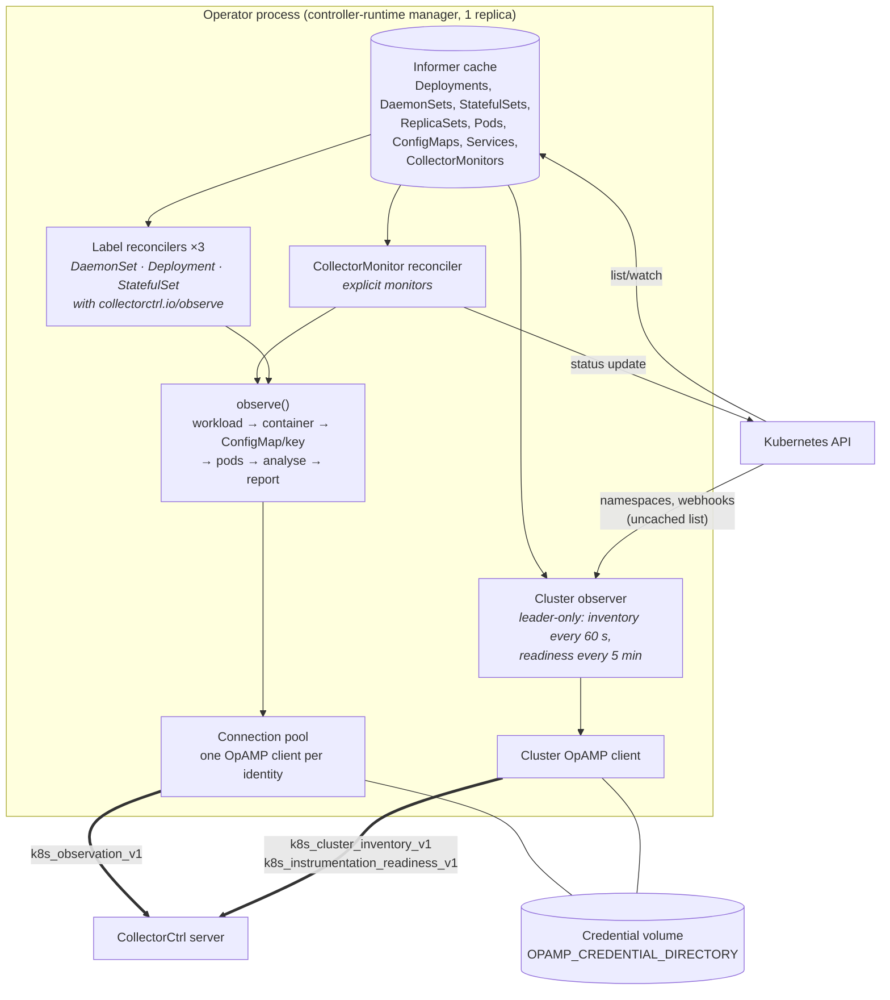
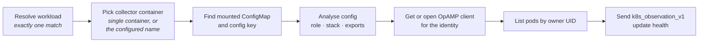
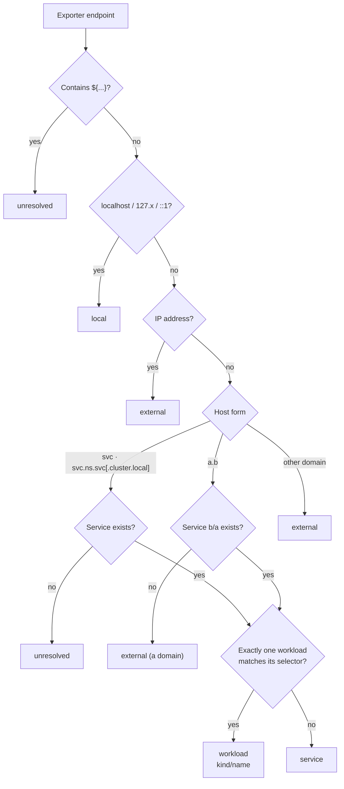
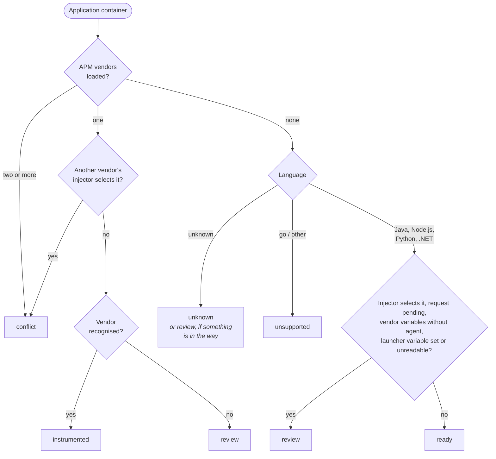

# Architecture

This document explains how the operator turns Kubernetes objects into what CollectorCtrl shows: which parts run,
what triggers them, how each collector is identified, what goes over the wire and how role, stack and topology are
inferred. For installation and settings see [installation.md](installation.md) and [configuration.md](configuration.md).

## Design principles

1. **Observe, never control.** The operator writes nothing except `CollectorMonitor` status. Deployment stays with
   the customer's Helm charts, vendor operators and CI/CD.
2. **Opt in.** Configuration is read only from collectors that opt in (label or `CollectorMonitor`). Everything else
   contributes metadata and image names only.
3. **Infer from evidence.** Role, stack and topology come from configuration and Kubernetes metadata, never from
   workload names. Every inference carries its source and reasons.
4. **Say what is unverified.** A mounted ConfigMap is not proof of the loaded config; a ready pod is not proof of
   delivered telemetry. Both are reported as unverified.
5. **Additive contracts.** Wire messages are versioned and only gain optional fields.

## Components

| Component | Source | Triggered by | Writes |
| --- | --- | --- | --- |
| CollectorMonitor reconciler | `operator/controllers/collectormonitor_controller.go` | Monitor changes; Pod, ConfigMap or workload changes in the monitor's namespace; report interval | Monitor `status` |
| Label reconcilers | `operator/controllers/label_controller.go` | Labelled workload created, updated or deleted; label added or removed; Pod, ConfigMap or monitor changes in the namespace; report interval | Nothing (errors go to the log) |
| Analysis | `operator/controllers/insight.go`, `internal/otelconfig` | Every observation | Nothing |
| Cluster observer | `operator/controllers/cluster_observer.go` | Timer (60 s), leader only | Nothing |
| Readiness scan | `operator/controllers/readiness.go`, `internal/readiness` | Cluster observer, every `readiness.interval` (5 min) | Nothing |
| OpAMP client | `pkg/opamp` | Reconcilers | Credentials on the credential volume |

## The observation pipeline

Both reconcilers run the same `observe()` step. The label reconciler builds an in-memory monitor from the workload's
annotations; the CollectorMonitor reconciler uses the resource as written.

Each step fails closed: an ambiguous match is an error, never a guess.

- **Workload.** A monitor must match exactly one Deployment, DaemonSet or StatefulSet in its namespace.
- **Container.** A single-container pod needs nothing. Multi-container pods need `collectorContainer` or the
  `collectorctrl.io/container` annotation; the application container is never inspected.
- **ConfigMap.** Only ConfigMaps mounted into the collector container count, including projected volumes. If several
  match, a name is required. A key excluded by volume `items` or not reachable through `subPath` is rejected.
- **Config key**, when not configured:
  1. the only key named `*.yaml` or `*.yml`;
  2. otherwise the only key mounted through volume `items` to a `*.yaml` or `*.yml` path (vendor charts store `relay`
     and mount it as `relay.yaml`);
  3. otherwise the only key of a single-key ConfigMap;
  4. otherwise an error asking for `config-key`.
- **Pods.** Attributed by controller owner UID (Deployment → ReplicaSet → Pod), so overlapping labels never pull in
  another workload's pods. Terminating, Succeeded and Failed pods are never counted as ready.

### Precedence between label and CollectorMonitor

A workload can be selected by both the label and a `CollectorMonitor`. The monitor wins:

- the label reconciler skips any workload that a monitor in the same namespace resolves to, and closes its own
  connection for it;
- if the label path still holds the identity, the monitor's connection takes it over;
- the reverse never happens: label discovery cannot displace a monitor.

## Identities and connections

| Connection | OpAMP identity (`service.instance.id`) | Count | Carries |
| --- | --- | --- | --- |
| Observed collector | `k8s://<cluster-id>/<workload-uid>/<container>` | One per collector workload | `k8s_observation_v1` and readiness health |
| Cluster observer | `k8s://<cluster-id>/cluster-observer` | One per cluster | `k8s_cluster_inventory_v1`, `k8s_instrumentation_readiness_v1` |

- **Cluster ID** is `CLUSTER_ID`, or the UID of the `kube-system` namespace (stable for the life of the cluster).
  Namespace-scoped installs must set it.
- **Agent attributes** include `k8s.cluster.name`, `k8s.cluster.id`, `k8s.namespace`, `k8s.workload.type`,
  `k8s.workload.name`, `k8s.workload.uid`, `k8s.container.name`, `k8s.configmap.name`,
  `collectorctrl.management.mode=observe`, and, when known, `collectorctrl.discovery`, `collectorctrl.stack` and
  `collectorctrl.role`. The cluster connection adds `collectorctrl.k8s.role=cluster-observer`, so the server keeps
  it out of the workload list.
- **Authentication.** On first connect an enrollment token (`cce_…`) is exchanged for a per-identity credential. The
  credential is written to the credential volume **before** it is acknowledged, then reused on reconnects and
  restarts. Revoked identities never fall back to enrollment.
- **Endpoint pinning.** Every connection goes to the administrator's `OPAMP_SERVER`. A monitor's `opampServer` must
  match it exactly, and server-offered connection changes are refused.
- **Server commands** (restart, config push, emergency override) are refused: the operator is observation-only.
- **Reconnect on change.** A client is replaced when its settings change, for example a role or stack change,
  secret rotation or endpoint change. ConfigMap content changes are reported without reconnecting.

## Wire contracts

Both messages are OpAMP custom messages with capability `collectorctrl`. Fields are only ever added.

### `k8s_observation_v1` (per collector, every report interval)

| Field | Meaning |
| --- | --- |
| `source`, `runtime_verified` | Always `kubernetes-api` and `false`: this is an API snapshot, not runtime evidence |
| `observed_at`, `report_interval_seconds` | When the snapshot was taken and how often to expect one |
| `namespace`, `workload_kind`, `workload_name`, `workload_uid`, `collector_container` | The observed workload |
| `configmap_name`, `configmap_key`, `resource_version`, `config_hash` | The mounted config and its SHA-256 |
| `config_yaml` | The config itself, **only** with `report-config` / `reportConfig` |
| `desired_pods`, `ready_pods`, `pods[]` | Readiness, plus per pod: UID, name, node, phase, ready, image, restarts, reason, terminating |
| `discovery` | `label` or `collectormonitor` |
| `stack`, `stack_source` | Group name and where it came from |
| `role`, `role_source`, `role_reasons[]` | Inferred (or annotated) role and the evidence |
| `receivers[]`, `processors[]`, `exporters[]` | Component IDs used in pipelines (connectors excluded) |
| `exports[]` | `exporter`, `endpoint`, `target` (`workload`, `service`, `external`, `local`, `unresolved`), plus `namespace`, `kind`, `name`, `service` when resolved |
| `config_error` | Why the config could not be analysed, if it could not |

The server treats a snapshot as current only if both its source time and its receipt time fall within
`max(2 min, 2 × interval + 30 s)` (with 30 s clock-skew tolerance). Older or replayed snapshots never replace newer
ones, even across reconnects.

### `k8s_cluster_inventory_v1` (per cluster, every 60 s)

| Field | Meaning |
| --- | --- |
| `source`, `observed_at`, `report_interval_seconds` | As above |
| `cluster_id`, `cluster_name` | The cluster |
| `collectors[]` | `namespace`, `kind`, `name`, `uid`, `container`, `image`, `stack`, `stack_source`, `opted_in`, `monitored` |
| `truncated` | `true` if the list was capped at 2,000 entries |

A workload is listed when a container image's **repository path** (never its tag) contains
`opentelemetry-collector`, `otelcol`, `otel-collector`, `aws-otel-collector`, `elastic-otel-collector`,
`dynatrace-otel-collector`, `nrdot-collector` or `grafana/alloy`.

### `k8s_instrumentation_readiness_v1` (per cluster, every 5 minutes)

| Field | Meaning |
| --- | --- |
| `source`, `observed_at`, `report_interval_seconds`, `cluster_id`, `cluster_name` | As above |
| `registry_checked` | Always `false` in 0.8: image config (Dockerfile `ENV`) was not read |
| `injectors_checked` | `false` when namespaces or webhooks could not be listed (namespace-scoped install, RBAC) |
| `injectors[]` | APM injector webhooks: `name` (MutatingWebhookConfiguration), `vendor`, `mode` (`request` or `selector`), `webhooks[]`, `failure_policy` |
| `workloads[]` | `namespace`, `kind`, `name`, `uid`, `stack`, `stack_source`, `pod` (running pod inspected, if any), `verdict`, `containers[]` |
| `containers[]` | `name`, `image`, `language`, `language_source`, `agents[]`, `requests[]`, `selected_by[]`, `launcher[]`, `vendor_env[]`, `verdict`, `findings[]`, `reasons[]` (finding messages, for older readers) |
| `findings[]` | `code` (stable, see below), `severity` (`blocker`, `warning`, `info`), `subject`, `message` |
| `agents[]` | `vendor`, `language`, `mechanism`, `evidence`, `injected` (only in the running pod) |
| `launcher[]` | `name`, `source` (`literal`, `configmap`, `secret`, `field`, `resource`, `envfrom-configmap`, `envfrom-secret`), `resolved`, `entries[]` (agent-loading parts only), `other_flags` (count), `in_pod` |
| `summary` | Workloads per verdict, counted before truncation |
| `truncated` | `true` if more than 2,000 workloads |

#### Finding codes

Codes are the machine-readable contract: the server maps them to the guided stage and next step, and AI agents
act on them instead of parsing messages. New codes may be added; existing codes never change meaning.

| Code | Severity | Subject | Meaning |
| --- | --- | --- | --- |
| `multiple_vendors` | blocker | vendors, comma-separated | Agents from two vendors are loaded in one process |
| `injector_adds_vendor` | blocker | webhook configuration | Another vendor's injector selects a pod that already has an agent |
| `unrecognised_agent` | warning | evidence | An agent is loaded but its vendor is not recognised |
| `injector_selects` | warning | webhook configuration | A vendor's injector will instrument new pods of an uninstrumented workload |
| `injection_requested` / `injection_not_applied` | warning | annotation or label | Injection is requested; not yet applied, or applied to no running pod |
| `vendor_env_without_agent` | warning | variable prefix | Vendor variables (e.g. `DD_*`) without a visible agent loader |
| `launcher_unreadable` | warning | variable | A launcher variable comes from a Secret or a missing ConfigMap |
| `envfrom_secret_unread` | warning | Secret | `envFrom` a Secret whose keys could set launcher options |
| `launcher_set` | info | variable | A launcher variable is set and loads no agent; an injector appends to it |
| `agent_loaded` | info | vendor | One agent and how it is loaded |
| `language_unknown`, `language_unsupported` | info | language | The language is not visible, or has no auto-instrumentation path |
| `java_opts_ignored`, `image_env_not_checked`, `no_running_pod`, `injectors_not_checked` | info | | Context and limits |

## Inference rules

All analysis lives in `internal/otelconfig` (parsing, roles, endpoints) and `operator/controllers/insight.go`
(stacks, topology). It is tested against rendered vendor charts in `operator/controllers/vendorcharts_test.go`.

### Components

Only components referenced by `service.pipelines` count; defined-but-unused components are ignored. Component types
are compared with underscores removed, so `kubelet_stats` matches `kubeletstats` and `otlp_http` matches `otlphttp`.
Components declared under `connectors:` (e.g. `spanmetrics`, `forward`) are listed separately and are neither
receivers nor exporters.

### Role

| Evidence in pipelines | Role |
| --- | --- |
| `kubeletstats`, `hostmetrics`, `journald`, or `filelog` including `/var/log/pods` or `/var/log/containers` | agent |
| `k8s_cluster`, `k8sobjects`, `k8s_events` | cluster-receiver |
| `tail_sampling` processor, `loadbalancing` exporter | gateway |
| Two or more of the above | all-in-one |
| None, with an OTLP receiver | agent if DaemonSet, otherwise gateway |
| None, without OTLP | agent if DaemonSet, otherwise unknown |
| Config missing or unparsable | unknown |

`groupbytrace` is deliberately not gateway evidence: node agents use it too. The `collectorctrl.io/role` annotation
overrides the result (`role_source: annotation`); unknown values are ignored and noted in the reasons.

### Stack

The first that applies:

1. `collectorctrl.io/stack` annotation (`annotation`)
2. owner reference to an `OpenTelemetryCollector` (`otel-operator`)
3. label `app.kubernetes.io/instance`, i.e. the Helm release (`helm-release`)
4. label `argocd.argoproj.io/instance` (`argocd-app`)
5. the workload's own name (`standalone`)

### Topology

Endpoints are read from `endpoint`, `traces_endpoint`, `metrics_endpoint`, `logs_endpoint` and `ingest_url`, then a
vendor `domain`. For the `loadbalancing` exporter they come from its static, DNS and Kubernetes resolvers. Repeated
hosts from one exporter are collapsed.

### Instrumentation readiness

All rules live in `internal/readiness` and are pure functions over pod specs, tested in `readiness_test.go`.

**Scope.** Every Deployment, StatefulSet and DaemonSet outside `readiness.excludeNamespaces` and the operator's own
namespace. Containers whose image is a collector, service-mesh proxy, log shipper or similar infrastructure are
skipped; a workload with no application container is left out.

**Evidence.** For each application container: command and args, `env` (literal values and ConfigMap keys),
`envFrom` ConfigMaps, init containers, volumes, pod labels and annotations. The same is read from the newest
running pod of the workload, so agents added by admission webhooks are found and marked `injected`. Secret
references are recorded as unresolved, never read.

**Agents.** Loaders first, then injector traces for vendors not already found:

| Mechanism | Read from | Examples |
| --- | --- | --- |
| `javaagent` | `-javaagent:` / `-agentpath:` in `JAVA_TOOL_OPTIONS`, `JDK_JAVA_OPTIONS`, `_JAVA_OPTIONS`, `JAVA_OPTS`, command line | `opentelemetry-javaagent`, `dd-java-agent`, `newrelic.jar`, AppDynamics `javaagent.jar` |
| `node-require` | `--require` / `--import` in `NODE_OPTIONS` or the command | `@opentelemetry/auto-instrumentations-node`, `dd-trace`, `newrelic`, `@splunk/otel` |
| `python-wrapper`, `python-path` | Wrapper command; `PYTHONPATH` entries | `opentelemetry-instrument`, `ddtrace-run`, `newrelic-admin` |
| `dotnet-profiler`, `dotnet-startup-hook` | `CORECLR_ENABLE_PROFILING=1` with the profiler GUID or path; `DOTNET_STARTUP_HOOKS` | OpenTelemetry, Datadog and New Relic profiler GUIDs |
| `ld-preload` | `LD_PRELOAD` | Dynatrace `liboneagentproc.so`, Datadog injector |
| `init-container`, `injected-annotation` | Injector init containers and markers | `opentelemetry-auto-instrumentation-java`, `datadog-lib-java-init`, `oneagent.dynatrace.com/injected` |

**Requests** are intent, not agents: `instrumentation.opentelemetry.io/inject-*` on the pod template or namespace,
New Relic's `instrumentation.newrelic.com/inject-*`, Datadog's `admission.datadoghq.com/enabled` and `*-lib.version`,
Elastic's `co.elastic.apm/attach`.

**Injectors.** Mutating webhooks that act on pod `CREATE` and belong to an APM vendor (by configuration, webhook
or service name). Hooks that only add metadata or settings (New Relic metadata injection; Datadog's agent config,
tags and CWS hooks) are ignored. `request` injectors (OTel Operator, New Relic, Elastic) select a pod only when it
carries their request; `selector` injectors (Dynatrace, Datadog library injection, Instana) select every pod their
namespace and object selectors match. Splunk installs the upstream OTel Operator, so Splunk and OpenTelemetry count
as one family.

**Language**: from a language-specific agent, else the command (`java`, `node`, `gunicorn`, `dotnet`, ...), else a
majority of well-known variable names (`JAVA_HOME`, `NODE_ENV`, `PYTHONUNBUFFERED`, `ASPNETCORE_URLS`,
`GOMAXPROCS`, ...), else an exact base-image name (`eclipse-temurin`, `node:20-alpine`, `python:3.12-slim`,
`mcr.microsoft.com/dotnet/aspnet`). Application images rarely reveal more, so many containers stay `unknown`; the
`collectorctrl.io/language` annotation on the workload (`java`, or per container `app=java,worker=python`) settles
it and wins over inference.

Every verdict except *instrumented*, *conflict* and *unsupported* carries the caveat that image `ENV` was not
checked. *Unknown* containers still get merge warnings for any launcher variable, so nothing is hidden.

## Failure behaviour

| Situation | Result |
| --- | --- |
| Ambiguous workload, container, ConfigMap or key | Monitor status `Error` with the reason (label path: log line); no connection |
| Config unparsable | Still observed and reported; role `unknown`, `config_error` set |
| Server unreachable | Snapshots are dropped while disconnected; the next interval sends a fresh one. Status `Disconnected` |
| Credential volume lost | Affected identities must be reset in CollectorCtrl before they can enroll again (see [installation.md](installation.md#credentials-and-recovery)) |
| Workload deleted | Connection closed; the entry stays offline in CollectorCtrl until removed |
| Operator restart | Identities and credentials reused; observation resumes within one interval |
| Namespaces or webhooks not listable | Readiness still sent with `injectors_checked: false`; every container says injectors were not checked |
