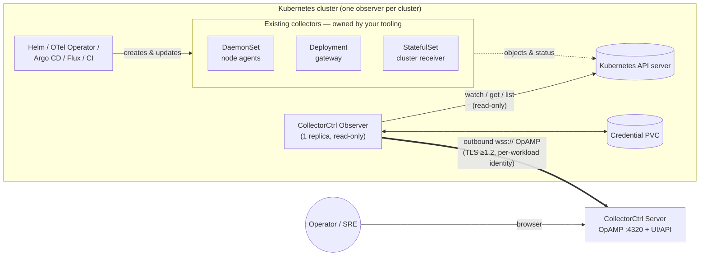
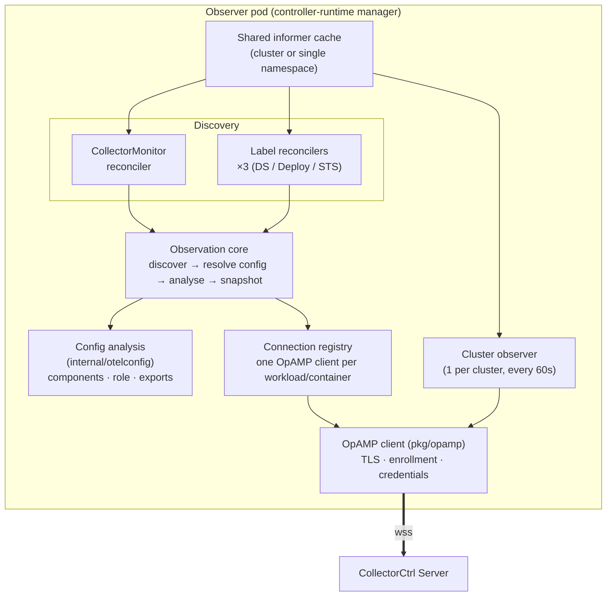
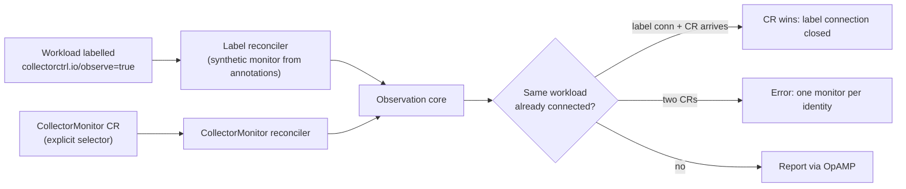
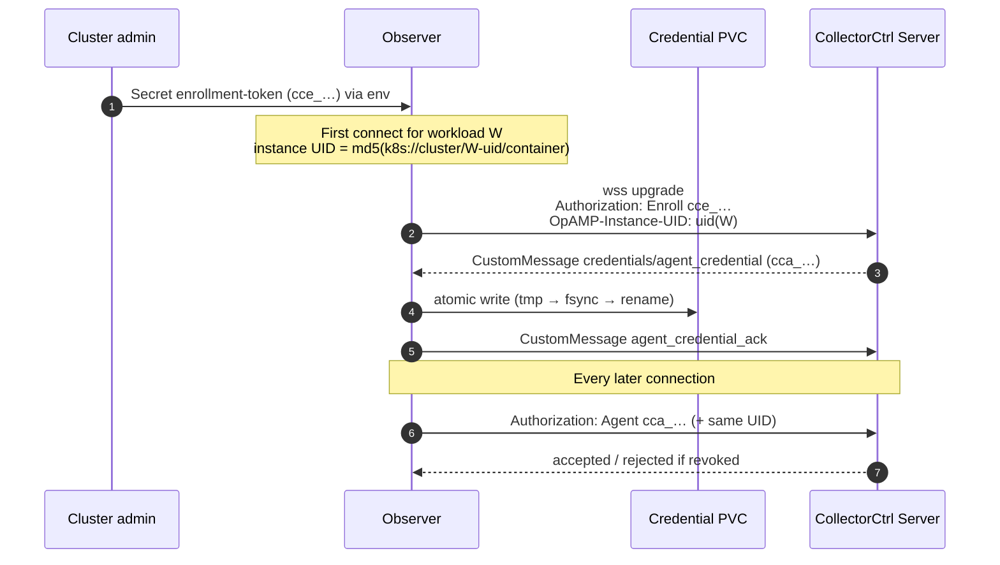
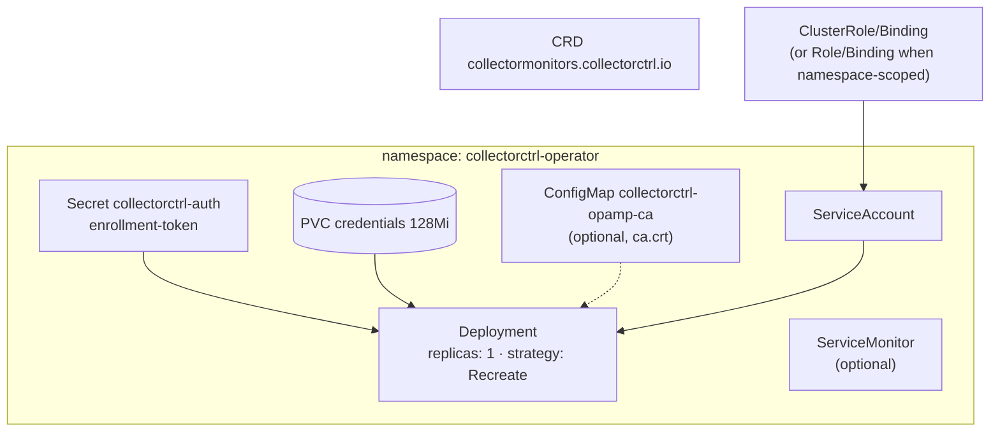
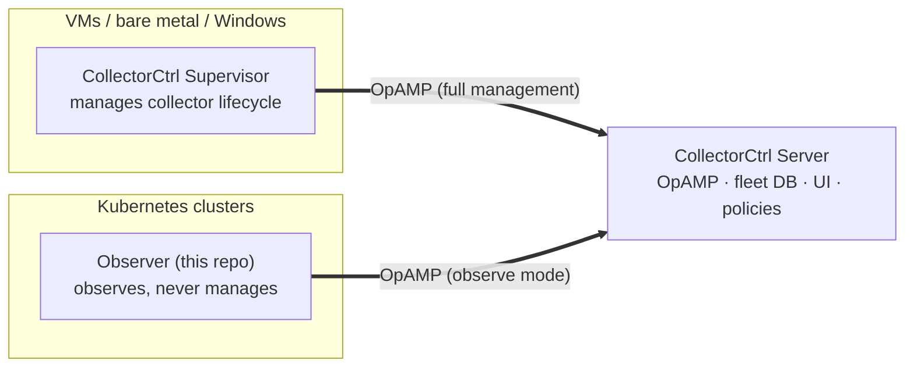

# CollectorCtrl Kubernetes Observer — High-Level Design (HLD)

> **Applies to:** operator `v0.6.0-beta`+ (observation release), CollectorCtrl server `v0.6.0-beta`+
> **Audience:** platform engineers, SREs, security reviewers, and contributors new to the codebase
> **Companion:** [Low-Level Design (LLD)](LLD.md) for code-level detail

---

## 1. Purpose

Most organisations already deploy OpenTelemetry Collectors on Kubernetes through
**their own tooling**: vendor Helm charts (Splunk, Coralogix, Datadog, ADOT,
Elastic…), the upstream OpenTelemetry Operator, Argo CD / Flux, or plain CI
pipelines. Those tools own the workloads.

The CollectorCtrl Kubernetes Observer gives CollectorCtrl **fleet visibility
into those collectors without taking ownership of them**. It runs once per
cluster, reads the collectors' Kubernetes objects, and reports what it sees to
the CollectorCtrl server over OpAMP. In the CollectorCtrl UI, Kubernetes
collectors then sit beside VM and Windows collectors that the Supervisor
manages.

### 1.1 Goals

| # | Goal |
|---|------|
| G1 | Show every opted-in collector workload in CollectorCtrl: health, pods, image, restarts, mounted config. |
| G2 | Infer each collector's **role** (agent, gateway, cluster receiver) and **topology** (who exports to whom) from its configuration. |
| G3 | Suggest collectors that have **not** opted in yet, from image metadata only. |
| G4 | Work with any installer (Helm, OTel Operator, GitOps, kubectl) and on any distribution (EKS, AKS, GKE, OpenShift, self-managed). |
| G5 | Be safe to install in production: read-only, least privilege, no inbound ports, per-workload revocable identity. |

### 1.2 Non-goals (this release)

- **No writes** to collector workloads, ConfigMaps or Secrets. No restarts, no config pushes, no "emergency mode".
- **No runtime verification.** The observer reports the *mounted* ConfigMap, not what the collector process actually loaded.
- **No telemetry-delivery verification.** Pod readiness ≠ data flowing.
- **No Git ownership mapping** (which repo/file produced the workload).
- **No collector self-metrics scraping** (`healthCheck.metricsPort` is reserved).

These are explicit design choices. The status conditions say **Unknown** for
the things the observer cannot prove instead of implying success.

---

## 2. System context

**Key properties**

- **Outbound only.** The observer opens WebSocket connections *to* the server. Nothing connects into the cluster.
- **Read-only.** RBAC grants `get/list/watch` on workloads, pods, ConfigMaps and services, plus `update` on its own CRD's status.
- **One install per cluster**, identified by a stable cluster ID (the `kube-system` namespace UID by default).

---

## 3. Building blocks

| Block | Responsibility | Code |
|-------|----------------|------|
| **Manager** | Starts the controllers, cache, health probes (`:8081`) and metrics (`:8080`). Resolves cluster ID and TLS settings at boot. | `cmd/operator/main.go` |
| **CollectorMonitor reconciler** | Observes the workload chosen by an explicit `CollectorMonitor` CR and writes the CR's status. | `operator/controllers/collectormonitor_controller.go` |
| **Label reconcilers** | Observe any Deployment/DaemonSet/StatefulSet labelled `collectorctrl.io/observe: "true"`. They build the monitor in memory, so no CR is needed. | `operator/controllers/label_controller.go` |
| **Observation core** | Resolves workload → collector container → mounted ConfigMap/key → pods, then builds one observation snapshot. | `collectormonitor_controller.go` (`observe`) |
| **Config analysis** | Parses the collector YAML. Finds the components used in pipelines, infers the role, and resolves exporter endpoints to in-cluster services/workloads. | `internal/otelconfig/*`, `operator/controllers/insight.go` |
| **Connection registry** | One OpAMP connection per observed workload/container. Reuses it while the inputs are unchanged, reconnects when identity-relevant inputs change, and stops on delete. | `ensureConnection`, `closeConnection` |
| **Cluster observer** | One extra connection per cluster. Every minute it lists collector-*looking* workloads (by image name) so the UI can suggest opt-ins. | `operator/controllers/cluster_observer.go` |
| **OpAMP client** | Endpoint pinning, TLS, enrollment → durable credential, health and custom messages. It refuses all server commands. | `pkg/opamp/*` |

---

## 4. How a collector gets observed

There are two ways in. Both feed the same observation core.

| | **Label opt-in** (recommended) | **CollectorMonitor CR** |
|---|---|---|
| How | `metadata.labels: collectorctrl.io/observe: "true"` on the workload | Apply a `CollectorMonitor` in the workload's namespace |
| Tuning | Annotations `collectorctrl.io/{container,config-map,config-key,stack,role,report-config,report-interval}` | `spec.collectorContainer`, `spec.configMapSelector`, `spec.reportConfig`, `spec.healthCheck.interval` |
| Status | Visible in the CollectorCtrl UI only | Also written to `kubectl get cmo` (phase, agents, healthy, conditions) |
| Precedence | Defers to a CR that selects the same workload | Wins |

---

## 5. What is reported

Each observed workload appears in CollectorCtrl as **one agent**, not one per
pod. Its pods are listed inside that agent. This keeps one WebSocket per
workload, so a 1,000-node DaemonSet costs one connection.

| Data | Source | Notes |
|------|--------|-------|
| Workload kind/name/UID, collector container | Workload spec | |
| Desired vs ready pods; per-pod node, phase, image, restarts, waiting/terminated reason, terminating flag | Pods owned by the workload (via owner UIDs, incl. Deployment → ReplicaSet) | Health = container readiness only |
| Mounted ConfigMap name, key, resourceVersion, SHA-256 | ConfigMap | Always |
| Config YAML | ConfigMap | **Only** when `reportConfig: true` (opt-in; review inline secrets first) |
| Receivers / processors / exporters / connectors in use | Parsed config | Only components referenced by `service.pipelines` |
| Role + reasons | Parsed config (+ workload kind as tie-breaker) | Overridable via `collectorctrl.io/role` |
| Stack (workloads deployed together) | Annotation → OTel Operator owner → Helm release → Argo CD app → standalone | Groups agent + gateway of one install |
| Export edges (`exporter → endpoint → target`) | Exporter endpoints resolved against Services and workloads | `workload`, `service`, `external`, `local`, `unresolved` |
| Cluster inventory (candidates) | Container images of all workloads | Metadata only. No config is read from workloads that have not opted in |

---

## 6. Security architecture

| Control | Design |
|---------|--------|
| **Transport** | `wss://` only, TLS ≥ 1.2, system roots plus an optional private CA bundle. There is no skip-verify option. |
| **Endpoint pinning** | The administrator sets `OPAMP_SERVER`. A CR's `spec.opampServer` must match it exactly, so a CR author cannot send credentials elsewhere. |
| **Per-workload identity** | Each workload/container enrolls once and gets its own `cca_` credential bound to its instance UID. The server can revoke a single workload. |
| **Durable credentials** | Credentials are persisted to a PVC *before* the server is acked, so a restart never falls back to the shared enrollment token. |
| **Least privilege RBAC** | Read-only on workloads/pods/ConfigMaps/services; `get` on the single `kube-system` namespace (cluster ID). Secret `get` only for names listed in `rbac.authSecretNames`. |
| **No control plane** | `OnCommand`, `OnOpampConnectionSettings` and the `emergency` message are refused. The observer cannot restart or reconfigure anything. |
| **Config privacy** | YAML is not uploaded unless `reportConfig` is enabled. Secret-backed config is never read. |
| **Pod hardening** | Non-root UID 65532, read-only root FS, all capabilities dropped, `RuntimeDefault` seccomp. Writes only to the credential PVC. |

---

## 7. Deployment view

| Topic | Decision | Why |
|-------|----------|-----|
| Replicas | **Exactly 1**, `Recreate` | The credential store supports one writer, and two replicas would hold duplicate OpAMP identities. |
| Leader election | Off by default | It isn't needed with one replica. Cluster-scoped runnables are still marked `NeedLeaderElection`, so enabling it stays safe. |
| Scope | Cluster-wide (default) or one namespace (`rbac.clusterScoped=false` → `WATCH_NAMESPACE`) | Namespace scope requires an explicit `clusterID`. |
| Install paths | Helm chart (supported), raw manifests + `deploy/deploy.sh` | OpenShift overlay: `values-openshift.yaml` |
| Image | `ghcr.io/collectorctrl/collectorctrl-k8s-operator/operator` | Built by `.github/workflows/build-operator.yml`; `v*` tags publish immutable versions |

---

## 8. Quality attributes

| Attribute | How it is met |
|-----------|---------------|
| **Scalability** | One connection per workload, not per pod. Inventory capped at 2,000 candidates per message. Informer cache serves all reads. |
| **Freshness** | Each observation is resent every `healthCheck.interval` (default 30s, clamped 5s–1h), plus immediately on any related workload/pod/ConfigMap change. The server treats an observation as stale after `max(2m, 2×interval+30s)`. |
| **Correctness** | Ambiguity is an error, not a guess: a selector matching ≠1 workload, a multi-container pod without `collectorContainer`, or several candidate ConfigMaps/keys. |
| **Resilience** | Disconnects only pause sending, and the next interval sends a fresh snapshot. Credentials survive restarts. Failed observations requeue after 30s. |
| **Honesty** | Status conditions report `Unknown` for runtime config and delivery. The health message says "container readiness only". |
| **Portability** | Pure Kubernetes API. No cloud SDKs. Works with any chart because it reads the rendered workload. |

---

## 9. Relationship to the rest of CollectorCtrl

The server tells the two apart by the agent attribute
`collectorctrl.management.mode=observe`. Observed agents never receive policy
rollouts, config pushes or upgrades. Their pods, role, stack and export
edges feed the fleet, Kubernetes inventory and topology views.

---

## 10. Roadmap (beyond this release)

1. Validate pod lifecycle and install across EKS, AKS, GKE (Standard/Autopilot) and OpenShift.
2. Verified ownership and explicit Git source bindings per workload.
3. Validated PR proposals for raw ConfigMaps, the official Helm chart and `OpenTelemetryCollector` resources. Git credentials stay in the server.
4. Vendor chart adapters and upstream sidecar discovery.
5. Emergency ownership handoff, only once durable recovery and controller coordination exist.

See the [LLD](LLD.md) for reconcile loops, data contracts, algorithms and failure handling.
