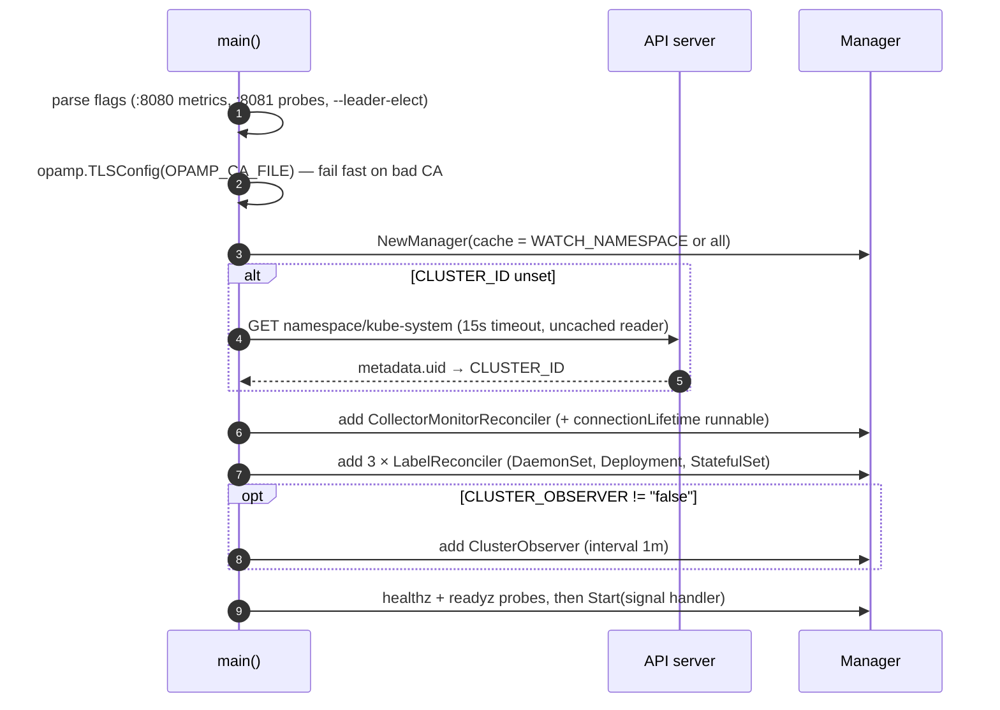
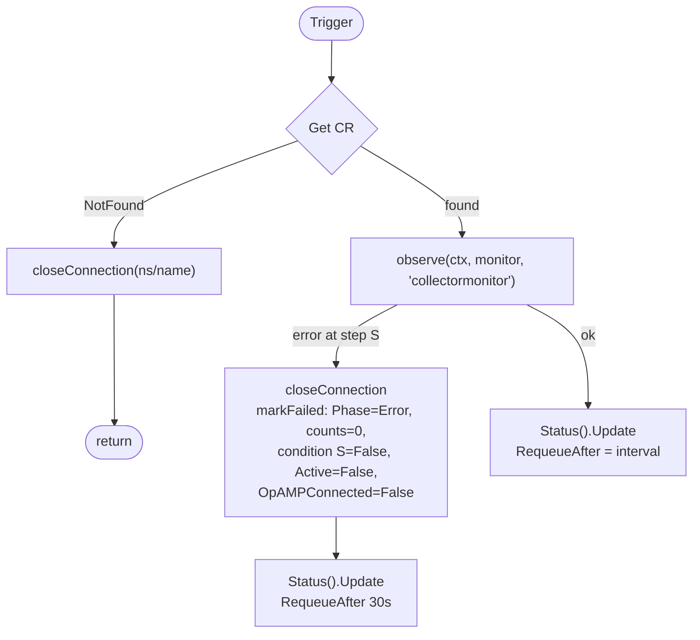
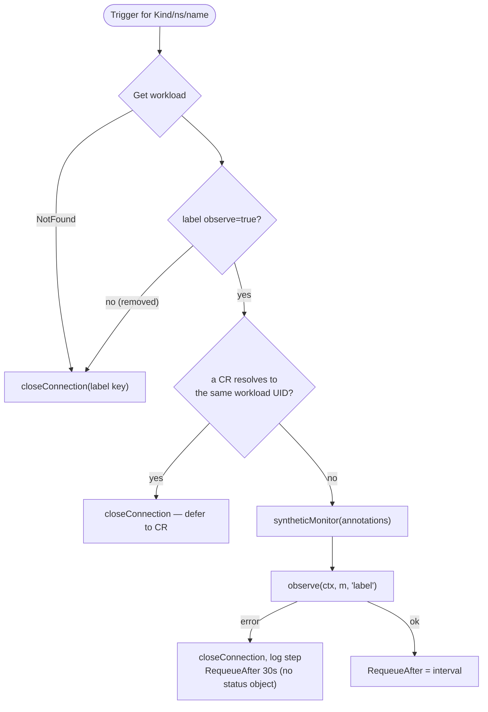
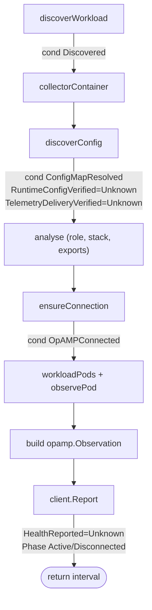
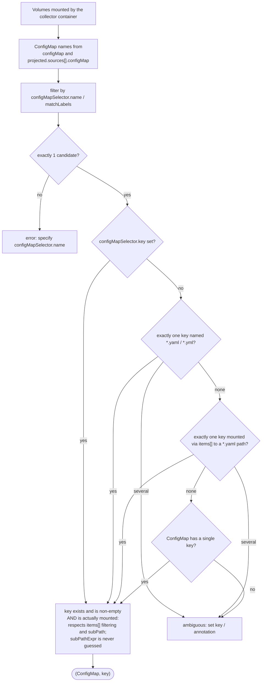
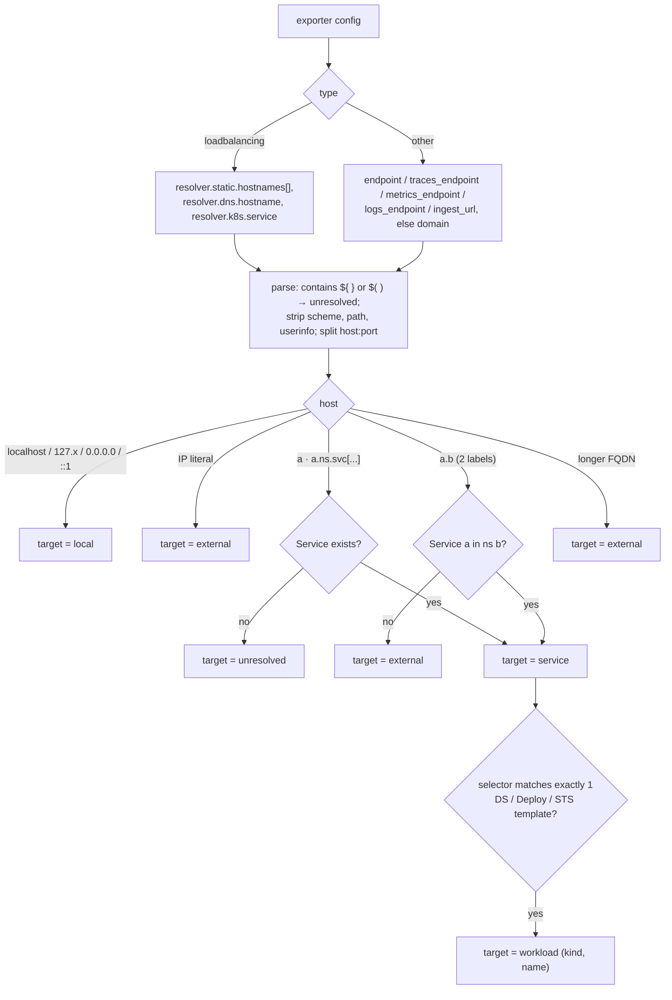
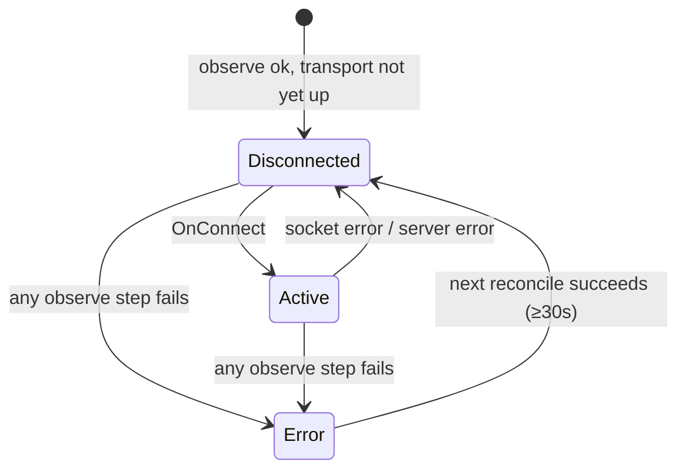
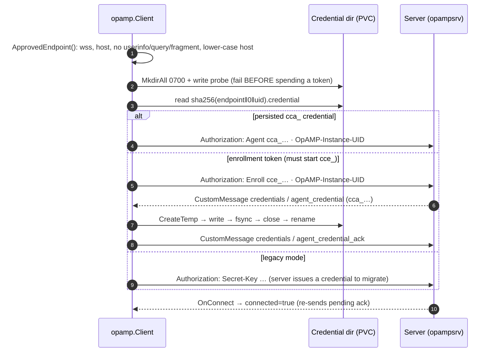

# CollectorCtrl Kubernetes Observer — Low-Level Design (LLD)

> **Applies to:** operator `v0.6.0-beta`+ · Go 1.24 · controller-runtime v0.17 · opamp-go v0.23
> **Read first:** [High-Level Design](HLD.md)

This document maps the design onto the code. It explains how each loop runs,
what goes over the wire, and how failures are handled. File references are
relative to the repository root.

---

## 1. Repository map

```
cmd/operator/main.go                  Process entry: flags, env, cluster ID, manager wiring
operator/api/v1alpha1/                CollectorMonitor CRD types (hand-written DeepCopy)
operator/controllers/
  collectormonitor_controller.go      CR reconciler + shared observation core + connection registry
  label_controller.go                 Label opt-in reconcilers (one per workload kind)
  insight.go                          Role/stack/export analysis glue, label & annotation names
  cluster_observer.go                 Cluster inventory runnable (collector candidates)
internal/otelconfig/
  analysis.go                         Parse collector YAML → components used in pipelines
  role.go                             Role inference rules
  exports.go                          Exporter endpoint extraction & parsing
pkg/opamp/
  client.go                           OpAMP client, Observation & ClusterInventory wire types
  credentials.go                      Endpoint pinning, enrollment, durable credential store
helm-charts/collectorctrl-operator/   Supported install (values.yaml, values-openshift.yaml)
deploy/                               Raw manifests + deploy.sh for clusters without Helm
operator/controllers/testdata/vendorcharts/  Rendered vendor chart manifests for golden tests
internal/integrationclient/           Process boundary for the server↔operator integration test
```

Not on the observation path (kept for the roadmap, not wired into `main`):
`pkg/git` (provider stubs), `internal/validator` (config pre-flight),
and most types in `pkg/api` (`FleetPolicy`, `ConfigChangeRequest`, …).
Only `api.AgentTypeKubernetes` is used.

---

## 2. Process start-up



### 2.1 Configuration surface

| Env var | Default | Used by | Meaning |
|---------|---------|---------|---------|
| `OPAMP_SERVER` | — (**required**) | all connections | Approved `wss://` endpoint. Pins every monitor. |
| `OPAMP_AUTH_MODE` | `enroll` | connections | `enroll` or `legacy`. Anything else is an error. |
| `OPAMP_ENROLL_TOKEN` | — | enroll mode | `cce_…` token, normally from Secret `collectorctrl-auth`. |
| `OPAMP_SECRET_KEY` | — | legacy mode | Shared secret, for migration only. |
| `OPAMP_CREDENTIAL_DIRECTORY` | — (**required**) | credentials | Writable PVC path, e.g. `/var/lib/collectorctrl/credentials`. |
| `OPAMP_CA_FILE` | — | TLS | Extra PEM bundle appended to system roots. |
| `CLUSTER_ID` | `kube-system` UID | identity | Must be unique and stable per cluster. Required when namespace-scoped. |
| `CLUSTER_NAME` | `CLUSTER_ID` | display | Human-readable cluster name for the cluster observer. Per-workload agents take it from the CR label `k8s.cluster.name`. |
| `CLUSTER_OBSERVER` | `true` | inventory | `false` disables the cluster connection. |
| `WATCH_NAMESPACE` | all | cache | Set by Helm when `rbac.clusterScoped=false`. |

---

## 3. Data model — `CollectorMonitor` (`collectorctrl.io/v1alpha1`)

Short names `cmo`/`cmos`. Printer columns: Phase, Agents, Healthy, Age.

| Field | Type | Effect in this release |
|-------|------|------------------------|
| `spec.workloadSelector.matchLabels` | map | Label selector in the CR's namespace. Required unless `name` is set. |
| `spec.workloadSelector.kind` | `DaemonSet\|Deployment\|StatefulSet` | Restricts the search. Empty searches all three. |
| `spec.workloadSelector.name` | string | Exact workload name. |
| `spec.collectorContainer` | string | Required when the pod template has more than one container (sidecars). |
| `spec.configMapSelector.{name,matchLabels,key}` | | Disambiguates mounted ConfigMaps/keys. |
| `spec.opampServer` | `^wss://` | Must equal `OPAMP_SERVER` after normalisation. |
| `spec.auth.secretRef.{name,key}` | | Per-monitor token from a Secret in the **same namespace**. Default key `enrollment-token` (`secret-key` in legacy). Needs Secret RBAC. |
| `spec.reportConfig` | bool, default `false` | Upload the ConfigMap YAML in the observation. |
| `spec.healthCheck.interval` | duration, default `30s` | Report interval, clamped to `[5s, 1h]`. |
| `spec.healthCheck.{enabled,metricsPort}` | | **Reserved**: not used. |
| `spec.driftDetection.*` | | **Reserved**: runtime verification is always Unknown. |
| `spec.emergencyMode.enabled` | | **Deprecated**: if true, condition `ControlEnabled=False/ObservationOnly`. |
| `spec.enrichWithNodeMetadata` | | **Reserved**. |
| `status.phase` | `Active\|Disconnected\|Error` (`Pending` reserved) | See §6. |
| `status.agentCount / healthyAgents` | int | Owned pods / ready pods. |
| `status.configMapRef` | `{name,namespace,key}` | Resolved config source. |
| `status.lastHeartbeat` | time | Last observation queued while connected. |
| `status.conditions[]` | | See §6. |

Label opt-in uses the same struct, built in memory by `syntheticMonitor()` and
never persisted:

| Annotation on the workload | Maps to |
|----------------------------|---------|
| `collectorctrl.io/container` | `spec.collectorContainer` |
| `collectorctrl.io/config-map` / `config-key` | `spec.configMapSelector.name` / `.key` |
| `collectorctrl.io/report-config: "true"` | `spec.reportConfig` |
| `collectorctrl.io/report-interval: 1m` | `spec.healthCheck.interval` |
| `collectorctrl.io/stack` | Stack override (also honoured on a CR) |
| `collectorctrl.io/role` | Role override: `agent\|gateway\|cluster-receiver\|all-in-one\|unknown` |

The synthetic monitor's name is `@label/<Kind>/<workload>`. `@` is illegal in
Kubernetes names, so its connection key can never collide with a real CR.

---

## 4. Reconcile loops

### 4.1 CollectorMonitor reconciler



**Triggers** (`SetupWithManager`):

| Watched object | Mapping | Note |
|----------------|---------|------|
| `CollectorMonitor` | itself | `GenerationChangedPredicate`, so status writes don't loop |
| `ConfigMap`, `Pod`, `Deployment`, `DaemonSet`, `StatefulSet`, `ReplicaSet` | `mapNamespace`: **every** CR in the object's namespace | Simple and correct; cost scales with CRs per namespace |
| timer | `RequeueAfter` | Periodic re-report (heartbeat) |

### 4.2 Label reconcilers (×3)



- **Predicates:** create/delete/generic pass if the object is labelled. Update passes if the **old or new** object is labelled, so removing the label still triggers a reconcile and closes the connection.
- **Secondary watches:** `ConfigMap`, `Pod`, `CollectorMonitor` changes enqueue labelled workloads of this kind in the same namespace (`mapNamespace` with a label selector).
- Controller names: `observe-daemonset`, `observe-deployment`, `observe-statefulset`.

### 4.3 Shared observation core — `observe()`



Each step returns the name of the condition that failed, so
`markFailed` can mark exactly that condition `False` with the error text.

---

## 5. Algorithms

### 5.1 Workload discovery — `discoverWorkload`

1. Reject a selector with neither `name` nor `matchLabels`.
2. List DaemonSets, Deployments and StatefulSets (or only `kind`) in the CR namespace with `matchLabels`, keeping only those whose name equals `name` when set.
3. **Exactly one** match is required. Otherwise the error reads *"selector matched N workloads; use one CollectorMonitor per workload…"*.

### 5.2 Collector container — `collectorContainer`

- `spec.collectorContainer` set → it must exist in the pod template.
- Unset → the template must have exactly one container. Otherwise this is an error: the observer never guesses between an app container and a sidecar.

### 5.3 Config resolution — `discoverConfig` + `configKey`



Steps 2–3 exist because most vendor charts (upstream, Splunk, Coralogix,
ADOT) store the config under a key such as `relay` and only name it `.yaml`
at mount time.

### 5.4 Pod attribution — `workloadPods`

The observer attributes pods by **controller owner UID**, not labels, so
overlapping label selectors never mix two workloads' pods:

- DaemonSet / StatefulSet: pods whose controller is the workload.
- Deployment: also include ReplicaSets whose controller is the Deployment, then pods controlled by those ReplicaSets.

Results are sorted by name.

`observePod` reads the collector container's status only:

- `ready = containerReady && !terminating && phase ∉ {Succeeded, Failed}`
- `reason` = waiting reason (e.g. `CrashLoopBackOff`), else terminated reason (e.g. `OOMKilled`)
- `desiredPods`: `DaemonSet.status.desiredNumberScheduled`, else `spec.replicas`, else 1.

### 5.5 Config analysis — `internal/otelconfig`

**Components** (`Parse`): only IDs referenced in `service.pipelines.*`
count. An ID listed under `connectors:` is reported as a connector even when
it appears in a pipeline's receivers/exporters. A config with no
`service.pipelines` is an analysis error (sent as `config_error`, not fatal).

**Role** (`InferRole`). The observer looks only at configuration, never at names:

| Signal | Evidence |
|--------|----------|
| agent | receivers `kubeletstats`, `hostmetrics`, `journald`; or `filelog` including `/var/log/pods` or `/var/log/containers` |
| cluster-receiver | receivers `k8s_cluster`, `k8sobjects`, `k8s_events` |
| gateway | processor `tail_sampling`; exporter `loadbalancing` |

- 1 signal → that role. 2 or more → `all-in-one` with per-role reasons.
- 0 signals → `otlp` receiver in a DaemonSet → agent; `otlp` elsewhere → gateway; a DaemonSet with no OTLP → agent; else `unknown`.
- `groupbytrace` is deliberately **not** a gateway signal, because node agents use it too.
- A valid `collectorctrl.io/role` annotation overrides the result (`role_source=annotation`). An unknown value is ignored and recorded in the reasons.

**Stack** (`stackOf`), first match wins:
`collectorctrl.io/stack` annotation → `OpenTelemetryCollector` owner reference
→ label `app.kubernetes.io/instance` (Helm) → label `argocd.argoproj.io/instance`
→ the workload's own name (`standalone`).

**Export edges** (`ExportEndpoints` + `resolveExports`):



Duplicate `host:port` pairs per exporter are de-duplicated. The server uses
these edges to draw agent → gateway → backend topology.

### 5.6 Cluster inventory — `ClusterObserver`

Every `Interval` (60s) it does the following:

1. List all `CollectorMonitor`s and resolve each to a workload UID, giving the *monitored* set.
2. List DaemonSets, Deployments and StatefulSets. A workload is a candidate when the **repository part** of any container image (tag and digest stripped) contains one of: `opentelemetry-collector`, `otelcol`, `otel-collector`, `aws-otel-collector`, `elastic-otel-collector`, `dynatrace-otel-collector`, `nrdot-collector`, `grafana/alloy`.
3. Record namespace, kind, name, UID, container, image, stack, `opted_in` (label) and `monitored` (CR).
4. Sort by `ns/kind/name` and truncate at **2,000** (`truncated=true`).
5. Send on the cluster connection (`AgentID k8s://<clusterID>/cluster-observer`).

No ConfigMaps are read for candidates.

---

## 6. Status conditions & phase

| Condition | True | False | Unknown (by design) |
|-----------|------|-------|---------------------|
| `Discovered` | `WorkloadResolved` (`Kind/name`) | `ObservationFailed` | |
| `ConfigMapResolved` | `MountedConfigResolved` | `ObservationFailed` | |
| `RuntimeConfigVerified` | | | `RuntimeEvidenceUnavailable`, always |
| `TelemetryDeliveryVerified` | | | `MetricsUnavailable`, always |
| `ControlEnabled` | | `ObservationOnly` (only when `emergencyMode.enabled`) | |
| `OpAMPConnected` | `Connected` | `Connecting` / `ConnectionFailed` / `ObservationFailed` | |
| `HealthReported` | | `ObservationFailed` | `DeliveryUnconfirmed` (no server ack) |
| `Active` | `Observing` | `Disconnected` / `ObservationFailed` | |



`lastHeartbeat` is set only when the observation was queued while connected.

---

## 7. Connection registry — `ensureConnection`

**Identity**

| Item | Value |
|------|-------|
| Agent ID | `k8s://<clusterID>/<workloadUID>/<container>` |
| OpAMP instance UID | `UUID(md5(agentID))`, deterministic so a restart keeps the same UID |
| Identifying attributes | `service.name=kubernetes`, `service.instance.id=<agentID>` |
| Non-identifying attributes | `k8s.cluster.name`, `k8s.cluster.id`, `k8s.namespace`, `k8s.workload.{type,name,uid}`, `k8s.container.name`, `k8s.configmap.name`, `collectorctrl.management.mode=observe`, `collectorctrl.health.source=container-readiness`, plus `collectorctrl.{discovery,stack,role}` when known |

The display cluster name comes from the CR label `k8s.cluster.name`, else the cluster ID.

**Reuse vs reconnect.** The registry is keyed by `namespace/name` (or the
label key). It stores a SHA-256 *fingerprint* of:

```
spec JSON | identity | clusterName | ConfigMap name | Secret resourceVersion |
endpoint | auth mode | token | discovery | stack | role
```

- Same fingerprint → reuse the client. **ConfigMap content changes do not reconnect.** They only change the next observation.
- Different fingerprint → stop the old client and start a new one, so the server sees fresh attributes.
- Another key already holds the same **identity**:
  - existing = label, new = CR → stop the label connection (CR wins);
  - otherwise → error *"already observed by X; use one monitor per identity"*.

**Lifetime.** Clients start on a long-lived background context. A
`connectionLifetime` runnable stops every client on manager shutdown.
Deleting a CR or removing the label calls `closeConnection`.

All registry access is guarded by one mutex.

---

## 8. OpAMP client — `pkg/opamp`

### 8.1 Start-up and authentication



- Capabilities: `ReportsStatus | ReportsHealth`. Custom capabilities: `collectorctrl`, `credentials`.
- `HeaderFunc` runs on every (re)dial and marks the client disconnected until `OnConnect`.
- An invalid persisted credential is a hard error, so the observer never silently re-enrolls. Restore the PVC, or reset enrollment explicitly.
- Server-side (`opampsrv/identity.go`): `Agent` must match the UID's enrolled credential (a mismatch raises an impersonation alert), and `Enroll` is refused for an already-enrolled UID.

### 8.2 Messages

| Direction | Mechanism | Type | Payload |
|-----------|-----------|------|---------|
| → server | `SetHealth` | ComponentHealth | `healthy = desired>0 && ready≥desired`. Map: `fleet/total_pods`, `fleet/ready_pods`, `fleet/desired_pods`, `pod/<name>` (`node= phase= restarts= reason=`) |
| → server | CustomMessage `collectorctrl` | `k8s_observation_v1` | `Observation` JSON (§9.1) |
| → server | CustomMessage `collectorctrl` | `k8s_cluster_inventory_v1` | `ClusterInventory` JSON (§9.2) |
| → server | CustomMessage `credentials` | `agent_credential_ack` | empty |
| ← server | CustomMessage `credentials` | `agent_credential` | `cca_…` |
| ← server | CustomMessage `collectorctrl` | `emergency` | **refused**: replies `emergency_ack:false:operator is observation-only` |
| ← server | `ServerToAgentCommand` | | **refused** |
| ← server | `OpAMPConnectionSettings` | | **refused** (endpoint/credentials are admin-controlled) |

`Report()` order: surface any credential-persist error → flush a pending ack
→ `SetHealth` → if connected, send the observation. While disconnected it
returns `nil`, and the next interval sends a fresh snapshot (no queue, no
replay). `ErrCustomMessagePending` (previous message still in flight) is
treated as success.

---

## 9. Wire contracts

Both payloads are **additive JSON**. New optional fields may be added, but
existing fields keep their meaning. Keep `pkg/opamp/client.go` in sync with
the server's `data.K8sObservation` / `data.K8sClusterInventory`.

### 9.1 `k8s_observation_v1`

```json
{
  "source": "kubernetes-api",
  "runtime_verified": false,
  "observed_at": "2026-10-19T18:00:00Z",
  "report_interval_seconds": 30,
  "namespace": "observability",
  "workload_kind": "DaemonSet",
  "workload_name": "otel-agent",
  "workload_uid": "5b1c…",
  "collector_container": "otel-collector",
  "configmap_name": "otel-agent",
  "configmap_key": "relay",
  "resource_version": "918273",
  "config_hash": "<sha256 of key contents>",
  "config_yaml": "<only when reportConfig>",
  "desired_pods": 3,
  "ready_pods": 2,
  "pods": [
    {"uid": "…", "name": "otel-agent-x1", "node": "ip-10-0-1-5", "ready": false,
     "phase": "Running", "image": "otel/opentelemetry-collector-contrib:0.116.0",
     "restarts": 7, "reason": "CrashLoopBackOff"}
  ],
  "discovery": "label",
  "stack": "otel-demo", "stack_source": "helm-release",
  "role": "agent", "role_source": "inferred",
  "role_reasons": ["uses kubeletstats, filelog"],
  "receivers": ["filelog", "kubeletstats", "otlp"],
  "processors": ["batch", "k8sattributes"],
  "exporters": ["otlp/gateway"],
  "exports": [
    {"exporter": "otlp/gateway", "endpoint": "otel-gateway:4317", "target": "workload",
     "namespace": "observability", "service": "otel-gateway", "kind": "Deployment", "name": "otel-gateway"}
  ],
  "config_error": ""
}
```

**Server validation** (`data.DecodeK8sObservation`). The server rejects the message when:

- the payload is larger than 2 MiB;
- `source ≠ kubernetes-api`, `runtime_verified = true`, or any of `workload_uid`, `namespace`, `collector_container`, `configmap_name`, `configmap_key`, `observed_at` is empty;
- `ready_pods` is negative, exceeds `len(pods)`, or does not equal the count of ready pods;
- a pod is ready **and** terminating, `Succeeded` or `Failed`;
- `report_interval_seconds` is outside `0–3600`;
- `config_yaml` is present and its SHA-256 differs from `config_hash`.

**Server freshness.** An observation is fresh while
`now − observed_at ≤ max(2m, 2×interval + 30s) + 30s skew`. An observation is
only accepted as new if its `observed_at` is later than the stored one, so
replays and reconnects never refresh old evidence. On acceptance the server
stores it in `agent_models.k8s_observation_json` and clears
`effective_config`, because an observed agent has no runtime config.

### 9.2 `k8s_cluster_inventory_v1`

```json
{
  "source": "kubernetes-api",
  "observed_at": "2026-10-19T18:00:00Z",
  "report_interval_seconds": 60,
  "cluster_id": "a1b2…", "cluster_name": "eks-prod-us-east-1",
  "collectors": [
    {"namespace": "observability", "kind": "DaemonSet", "name": "splunk-otel-collector-agent",
     "uid": "…", "container": "otel-collector", "image": "quay.io/signalfx/splunk-otel-collector:0.113.0",
     "stack": "splunk-otel-collector", "stack_source": "helm-release",
     "opted_in": false, "monitored": false}
  ],
  "truncated": false
}
```

---

## 10. RBAC matrix

| Resource | Verbs | Why |
|----------|-------|-----|
| `apps/{daemonsets,deployments,statefulsets,replicasets}` | get, list, watch | Discovery, pod attribution, inventory, export resolution |
| `pods`, `configmaps`, `services` | get, list, watch | Health, config, export resolution |
| `collectorctrl.io/collectormonitors` | get, list, watch | CR discovery |
| `collectorctrl.io/collectormonitors/status` | get, update, patch | Status only. The spec is never written |
| `namespaces` (`resourceNames: [kube-system]`) | get | Default cluster ID |
| `secrets` (`resourceNames: rbac.authSecretNames`) | get | Only if a CR uses `auth.secretRef`. Read via the uncached reader |

With `rbac.clusterScoped=false`, the same rules apply as a `Role` in the
release namespace, and `clusterID` must be set explicitly.

---

## 11. Failure handling

| Failure | Where | Behaviour | Visible as |
|---------|-------|-----------|------------|
| Selector matches 0 or >1 workloads | discoverWorkload | Close conn, requeue 30s | `Discovered=False`, Phase `Error` |
| Multi-container pod, no `collectorContainer` | collectorContainer | same | `ConfigMapResolved=False` |
| 0 or >1 candidate ConfigMaps; ambiguous key; key filtered by `items`/`subPath` | discoverConfig | same | `ConfigMapResolved=False` with a hint |
| Config YAML unparsable / no pipelines | analyse | **Not fatal**. Role `unknown`, components empty | `config_error` in UI |
| `spec.opampServer ≠ OPAMP_SERVER`; non-`wss` | ApprovedEndpoint | Close conn, requeue | `OpAMPConnected=False` |
| Secret outside CR namespace / missing | ensureConnection | same | `OpAMPConnected=False` |
| Same workload claimed twice by CRs | ensureConnection | Second CR errors | `OpAMPConnected=False` |
| Credential dir not writable | prepareCredentials | Fails **before** spending a token | `OpAMPConnected=False` |
| TLS / dial / auth rejected | OnConnectFailed | Client keeps retrying (opamp-go backoff) | Phase `Disconnected`, `ConnectionFailed` |
| Credential persist failed | OnMessage | `authError` makes every `Report` fail | `HealthReported=False` |
| Revoked credential | server | Connection refused, no fallback to token | `Disconnected` |
| `CLUSTER_ID` unavailable | main | Process exits | CrashLoop with a clear log |
| Inventory error | ClusterObserver | Logged, retried next tick | Candidates stale in UI |

---

## 12. Concurrency & performance notes

- controller-runtime runs each controller single-worker by default (one reconcile per object at a time). The connection registry mutex serialises cross-controller access.
- Every read except Secrets and the boot-time `kube-system` lookup goes through the shared informer cache.
- `mapNamespace` fan-out: one ConfigMap or Pod event enqueues all monitors (or all labelled workloads of a kind) in that namespace. Pod churn in busy namespaces causes extra (cheap, cached) reconciles. Narrowing this with owner/mount indexes is a known optimisation.
- `workloadPods` lists all pods and ReplicaSets in the namespace per reconcile (cache-backed). An owner-UID field index would reduce CPU on very large namespaces.
- Each observed workload holds one WebSocket plus one opamp-go goroutine set. The cluster observer adds one more.

---

## 13. Testing

| File | What it pins down |
|------|-------------------|
| `operator/controllers/collectormonitor_controller_test.go` | Ambiguous workloads rejected; mounted, projected and `subPath` config discovery; ambiguous keys; keys without `.yaml`; sidecar container selection; pods by owner UID; pod lifecycle (terminating/completed never ready); deleted pods leave the next snapshot; deep copies never mutate the informer cache |
| `operator/controllers/label_controller_test.go` | Label opt-in without a CR; removing the label stops observation; CR precedence (both orders); annotation mapping; role/stack/topology analysis; role override; unreadable config is non-fatal; stack precedence; export resolution edge cases |
| `operator/controllers/connection_security_test.go` | A CR cannot redirect credentials to another endpoint or read another namespace's Secret; one monitor per credential identity |
| `operator/controllers/cluster_observer_test.go` | Image-based candidate detection; observed/opted-in marking; vendor-chart inventory |
| `operator/controllers/vendorcharts_test.go` | **Golden tests** on manifests rendered from real charts (`testdata/vendorcharts/`: upstream agent/gateway/cluster, Splunk, Coralogix, ADOT): stack, role and export edges a customer would see |
| `pkg/opamp/client_test.go` | TLS verification cannot be disabled; readiness uses desired instances; observation is a custom snapshot, never effective config; inventory has its own contract |
| `pkg/opamp/credentials_test.go` | Endpoint bound to admin configuration; persisted credentials survive restart and stay endpoint-bound; enrollment fails closed on unavailable/corrupt storage |
| `internal/otelconfig/otelconfig_test.go` | Only pipeline components count; role inference and all-in-one; unreadable config; endpoint extraction incl. `loadbalancing` and `${env}`; snake-case aliases and connectors |
| Server repo `scripts/test-k8s-integration.ps1` + `internal/integrationclient` (tag `k8s_integration`) | Real server ↔ operator over TLS as separate processes: enroll, first observation, restart with stored credential, revoked identity rejected |

```sh
go test ./... && go vet ./...
helm lint ./helm-charts/collectorctrl-operator --set opamp.enrollmentSecret=collectorctrl-auth
```

---

## 14. Extension points

| To add… | Change |
|---------|--------|
| A collector distribution to the candidate list | `collectorImageHints` in `cluster_observer.go` |
| A role signal | `nodeReceivers` / `clusterReceivers` / `gatewayProcs` / `gatewayExporters` in `internal/otelconfig/role.go`, plus a test |
| An exporter endpoint shape | `ExportEndpoints` in `internal/otelconfig/exports.go` |
| A stack source | `stackOf` in `insight.go` |
| A field in the observation | Add an optional `omitempty` field to `opamp.Observation` **and** the server's `data.K8sObservation` (+ its validation) in the same release |
| A new workload kind | `discoverWorkload`, `template`, `desiredPods`, `workloadPods`, `NewLabelReconcilers`, inventory listing, RBAC |
